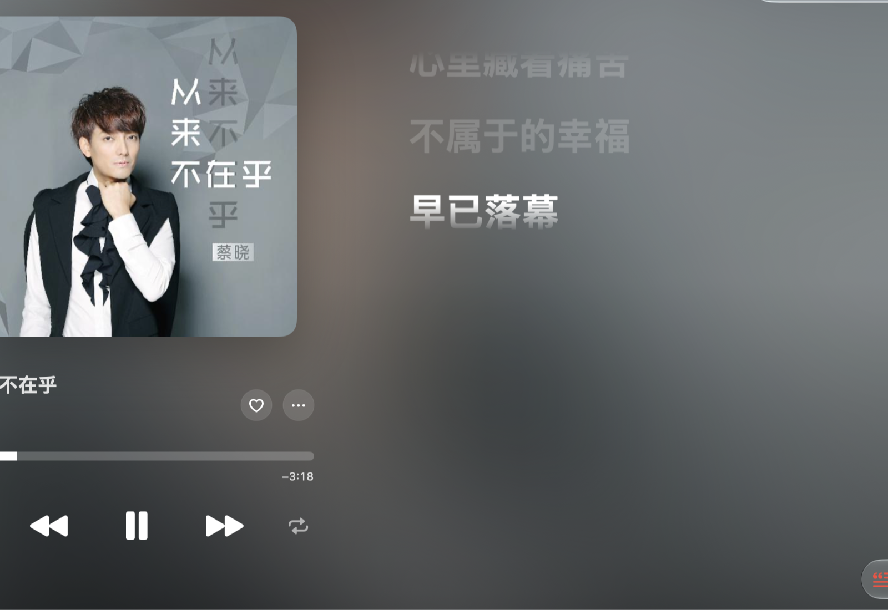
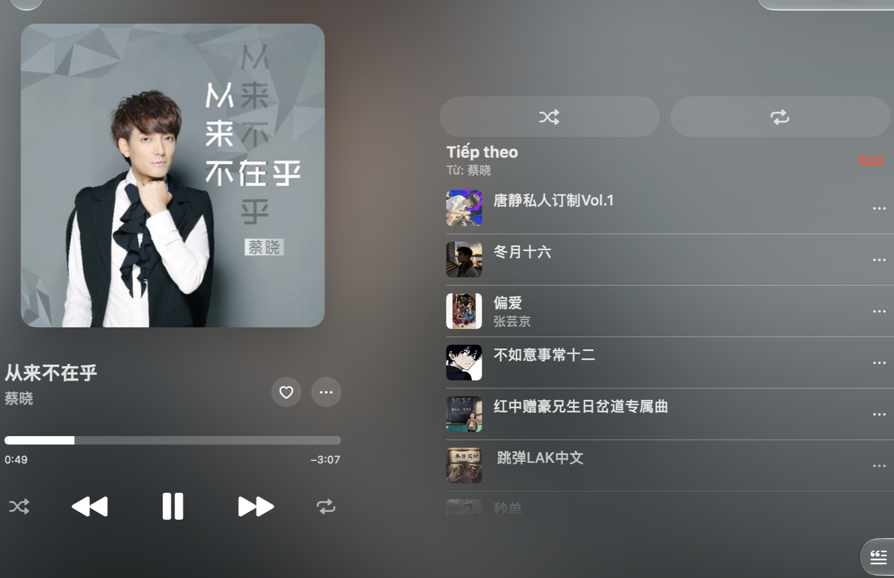
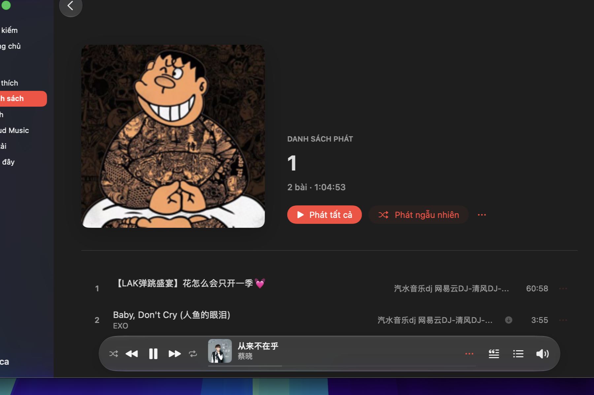
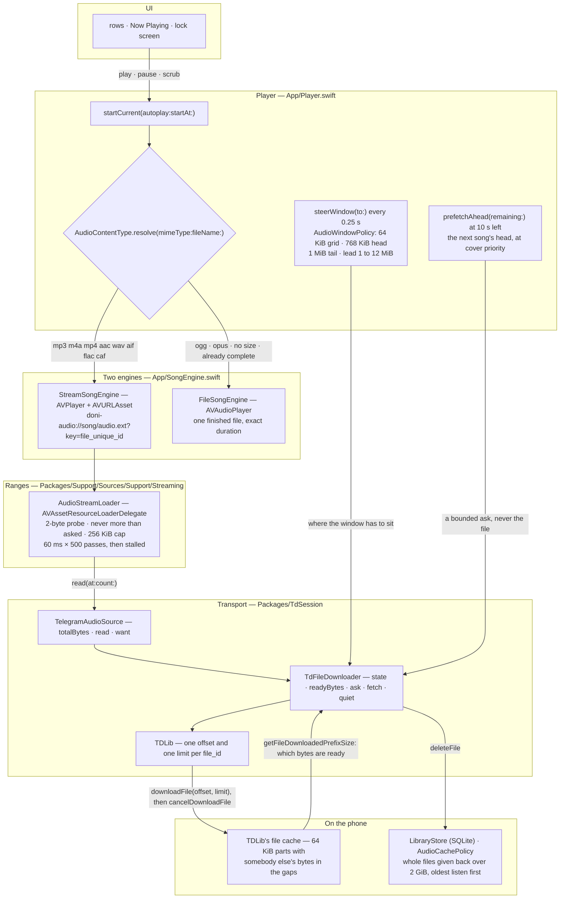
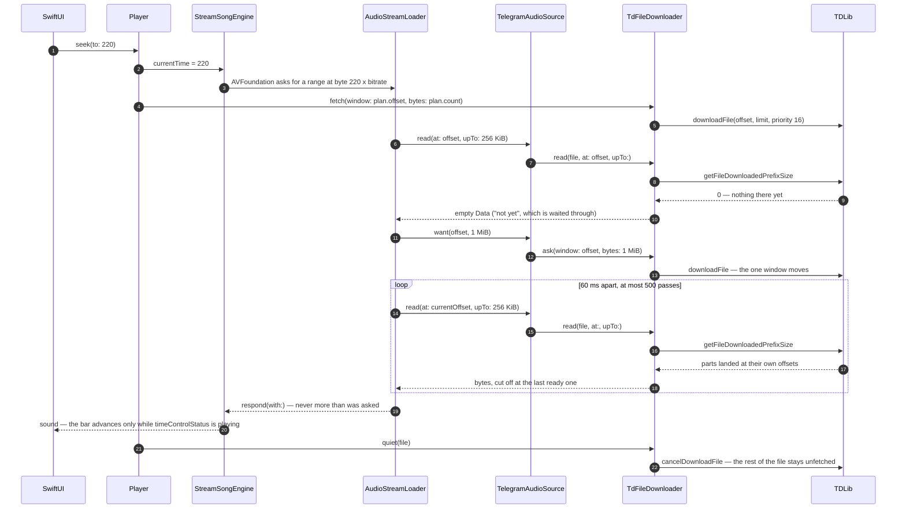

<div align="center">


# Doni

[English](../../README.md) · [Tiếng Việt](README.vi.md) · [中文](README.zh.md) · [Español](README.es.md) ·
[Français](README.fr.md) · [Русский](README.ru.md) · **العربية**

<a href="https://github.com/williamcachamwri/Doni/releases/latest"></a>

<a href="https://developer.apple.com/swift/"></a>


</div>

مشغّل موسيقى لآيفون يشغّل الأغاني الموجودة أصلًا في تيليجرام الخاص بك: القنوات التي تتابعها،
و«الرسائل المحفوظة» كمكتبتك الشخصية. لا خوادم في الخلف، ولا تسجيل، ولا تُرسَل أي بيانات.

### iOS

<table>
  <tr>
    <td></td>
    <td></td>
    <td></td>
    <td></td>
  </tr>
  <tr>
    <td align="center">الرئيسية.</td>
    <td align="center">يُشغَّل الآن.</td>
    <td align="center">السطر المُغنَّى على شاشة القفل.</td>
    <td align="center">قائمة أنشأتها.</td>
  </tr>
</table>

### macOS

<table>
  <tr>
    <td></td>
    <td></td>
    <td></td>
    <td></td>
  </tr>
  <tr>
    <td align="center">الرئيسية.</td>
    <td align="center">يُشغَّل الآن.</td>
    <td align="center">قائمة الانتظار.</td>
    <td align="center">قائمة تشغيل.</td>
  </tr>
</table>

## ما يفعله

- **يبدأ فورًا ويحمّل أثناء التشغيل.** الملف يُطلب على نطاقات بايت حول موضع الاستماع؛ القفز إلى 3:40
  يطلب الجزء القريب من 3:40 لا الملف كله.
- **يتذكر ما حمّله.** القطع تبقى في الهاتف حتى لو أُغلق التطبيق بالقوة، والأغنية التي استمعت إليها كاملة
  تعمل بلا شبكة.
- **«موسيقى السحابة» هي «الرسائل المحفوظة».** الرفع يرسل الملف إلى محادثتك ثم يحذف النسخة المحلية؛ وإذا
  حذفته في تيليجرام حذف من التطبيق أيضًا.
- **كلمات متزامنة** من lrclib وNetEase وAMLL وQQ Music. السطر المُغنى الآن يحل محل اسم الأغنية في شاشة
  القفل والـ Dynamic Island.
- **أغلفة** من وسوم الملف نفسه أو من الصورة المصغّرة في تيليجرام، ومع إعادة الطلب بضع مرات إن كان
  تيليجرام لم ينشئ الغلاف بعد.
- **ذاكرة مؤقتة بحد أقصى.** الحد تختاره أنت (2 جيجابايت افتراضيًا)، والأقل استماعًا يُفرَج عنه أولًا،
  والأغنية قيد التشغيل لا تُمسّ.
- ستّ لغات في الواجهة؛ نصّ السلاسل في الشيفرة بالفيتنامية.

## لماذا تيليجرام

لأن المكتبة هناك أصلًا. كل أغنية رسالة تحمل ملفًا، ولكل ملف معرّف `file_unique_id` يعني البايتات نفسها في
أي قاعدة بيانات. فتساؤلات «هل هذه الأغنية موجودة؟» و«أين توقفت؟» يجيبها البروتوكول بدل خادم أدفع ثمنه
ويقرأ بياناتك. يتولّى TDLib الشبكة: الدخول وإعادة المحاولة والتنزيل وتخزين الملفات وإعادة توجيه CDN.

## كيف يعمل البث فعلًا

لا طبقة هناك بالأسفل تطلب الملف كاملًا. يعطي `Player` لـ AVFoundation رابطًا بمخطّط خاص بالتطبيق،
ويسأل AVFoundation عن نطاقات بايتات، ويُقطع كل ردّ عند آخر بايت يؤكّده TDLib موجودًا على الهاتف. لا
يُنزَّل الملف كاملًا إلا إذا كانت الحاوية ما لا يفكّه AVFoundation، أو لم يكن لدى TDLib حجمٌ بعد، أو قال
النقل إن هذه البايتات لن تصل.

- `downloadFile` يأخذ إزاحة وحدًّا، لكن الحدّ لا يوقف التنزيل: يردّ TDLib بـ `ignore_download_limit`
  (`FileManager.cpp:3111`)، فيقرّر الحدّ متى يُشبع *السائل* فقط ويستمر الملف في التنزيل. لذا يتبع كل
  نافذة أمر `cancelDownloadFile`. والإلغاء لا يسترجع شيئًا: القطع كُتبت عند إزاحاتها هي
  (`FileDownloader.cpp:281`)، وقناع الجاهزية يواصل عدها.
- `getFileDownloadedPrefixSize` يخبر بعدد البايتات الجاهزة عند *أي* إزاحة لا عند البداية وحدها. هذا
  قناع جاهزية لا مؤشر «انتهى/لم ينتهِ»، وهو ما يجعل ملفًا ناقصًا صالحًا: القفز إلى موضع سبق أن قرأه
  الهاتف لا يكلّف شبكة.
- يحفظ TDLib إزاحة واحدة لكل `file_id` (`FileManager.cpp:3103-3107`) ويزحزح نافذة التنزيل الجاري بدل
  فتح تنزيل ثانٍ. فالنافذة واحدة وسؤالها من مكانين: يقول المحمِّل أين القارئ متى رجعت قراءة فارغة،
  ويقول نبض الربع ثانية في التطبيق أين يجب أن تستقر النافذة — ولا يُعاد السؤال إلا بعد سماع نحو نصفها،
  لأن إعادة السؤال كل ربع ثانية يلغي القطع القادمة.
- القطع 64 كيلوبايت وتبدأ النافذة على هذه الشبكة، لأن القطع لا يُقرأ إلا من أوله، فالإزاحة غير المطابقة
  تشتري بايتات لا يقرؤها أحد. والبايت خارج النافذة الجاهزة هو بيانات ملف آخر، ولهذا يتوقف الصوت عند
  انقطاع الشبكة بدل أن يصدّر ضجيجًا.
- يفتح AVFoundation التدفق باستطلاع بطول بايتين ويرفض ردًّا أطول مما طلب، وحمّال الموارد ليس رابطًا
  يفحصه ليعرف الصيغة: لا بد من تسليمه معرّف UTI للحاوية، وإلا رجع الخطأ بصيغة -11850 «the server is not
  correctly configured» الذي يبدو كعطل شبكة وهو في الحقيقة نصّ مفقود.

### الطبقات



حرفان من تلك الأضلاع هما الحجّة كلّها: `downloadFile` يتبعه دائمًا `cancelDownloadFile`، فيتوقف التنزيل
عند النافذة بدل أن يجرّ نفسه إلى نهاية مجموعة بحجم 166 ميغابايت؛ والقراءة التي تجيب AVFoundation تُقطع
عند `getFileDownloadedPrefixSize`، فتُنتظر الفجوة في وسط الملف بدل أن تُقرأ من فوقها. الضلع الأخير هو
النصف الآخر من الوعد: البايتات التي تبقى هي ما يجعل الأغنية قابلة للتشغيل بلا شبكة، والكنس الذي يعيدها
لا يمس الأغنية تحت رأس التشغيل أبدًا — يحرّر TDLib ملفات كاملة، فملفٌ نصفيّ يُطرد كاملًا لا نصفه.

### ما كلفة القفز إلى 3:40



### الأرقام وأين يسكن كل منها

| الرقم | المكان | ما يقرّره |
|---|---|---|
| 64 KiB | `AudioWindowPolicy.partBytes` | شبكة قطع TDLib؛ كل نافذة تبدأ عليها |
| 768 KiB | `AudioWindowPolicy.headBytes` | ما يطلبه البدء: قدرٌ يكفيه ليعثر المفكّك على حدّ إطار ويعلن المدة |
| 1 MiB | `AudioWindowPolicy.tailBytes` | الطلب الزائد لـ `m4a`/`mp4`/`aac`/`m4b` التي يسكن `moov` آخر ملفها |
| 1 → 12 MiB | `minimumLeadBytes` … `maximumLeadBytes` | كم تتقدّم النافذة على رأس التشغيل: يتضاعف بعد تعثّر المخزن، وينصف حين يفيض المخزن عن مثلَي الحاجة |
| 256 KiB | `AudioStreamLoader.chunkBytes` | أطول ردّ يناله طلب واحد |
| 1 MiB | `chunkBytes * 4` | إلى أي مدى يأمر المحمِّل النقلَ بالوصول حين ترجع قراءة فارغة |
| 60 ms × 500 | `pollNanoseconds` · `maximumIdlePasses` | كم يُنتظر النطاق — نصف دقيقة بلا شيء فيُسمّى stalled |
| 300 ms · 25 s | `TdFileDownloader.windowPoll` · `windowPatience` | كل كم ينظر التطبيق إلى النافذة هل هبطت، ومتى يحكم أنها لن تهبط |
| 16 · 1 | `audioPriority` · `coverPriority` | ملف رأس التشغيل مقابل الأغلفة والأغنية التالية المخمَّنة |
| 0,25 s | نبض `Player` | الموضع، ولقطة الاستئناف، وفحص التهيئة المسبقة، وتوجيه النافذة |
| 10 s | `Player.prefetchLead` | متى تُؤخذ رأس الأغنية التالية — رأسها فقط لا أكثر |
| 32 KiB · 64 KiB | `Library.probe` | كم تكلّف المدة حين لا تحملها الرسالة: الرأس، ذيلٌ لإضافة إلى `mp4` لم يُكتب للبث |
| 2 GiB | `Library.defaultQuota` | سقف المخزن، والمقياس الذي يقاس عليه `AudioCachePolicy` |

## البناء

يتطلّب iOS 26 وXcode 26 و[XcodeGen](https://github.com/yonaskolb/XcodeGen) وCMake وPython 3، إضافة إلى
`api_id`/`api_hash` من [my.telegram.org](https://my.telegram.org).

```sh
make vendor       # يبني TDLib وOpenSSL (نحو 20 دقيقة أول مرة)
make project      # ينشئ Doni.xcodeproj
cp Config/Tdlib.example.xcconfig Config/Tdlib.xcconfig   # بياناتك؛ هذا الملف لا يُرفع
make build        # التحذير خطأ
make device && make install
```

## الإصدار

إصدار واحد برقمين، كلاهما في `project.yml` ويتغيّران معًا: `MARKETING_VERSION` هو ما تعرضه صفحة «حول»
ويجب أن يطابق الوسم، و`CURRENT_PROJECT_VERSION` رقم بناء يحمل الإصدار نفسه في أرقامه
`90 | major | minor | patch`، لذا `9010000` يعني 1.0.0. تُكتب ملاحظات الإصدار مرة واحدة في
`RELEASE_NOTES.md` بلغتين وبنفس عدد الأسطر.

## الحدود

- توقيع بفريق مجاني: ثلاثة أجهزة، والشهادة تنتهي بعد سبعة أيام.
- ملف IPA المنشور غير موقَّع، ويلزم إعادة توقيعه بفريقك. `make release` يبنيه على جهازك ويوسم الإصدار ويدفع كل شيء ويرفق الملف؛ أما الـworkflow فيبقى تشغيله يدويًا من تبويب Actions للتأكد أن البناء يعمل من نسخة نظيفة.
- لا CarPlay حتى الآن: يلزم إذن `carplay-audio` أي حساب مطوّرين مدفوع.
- الكلمات من مصادر عامة؛ والأغنية التي لم يكتب أحد كلماتها تقوله التطبيق بصراحة بدل صفحة فارغة.
- فحص التحديث يخبرك فقط ويفتح صفحة النشر، ولا يثبّت شيئًا.

## الرخصة والحقوق

GPL-3.0 ([LICENSE](../../LICENSE)) — شاشة الكلمات وعدد من الواجهات مأخوذة من
[MeloX](https://github.com/youshen2/MeloX) المرخّص GPLv3. و**TDLib** برخصة BSL 1.0، و**OpenSSL**
Apache-2.0، و**SQLite** للمكتبة والقوائم، و**Telegram-iOS** GPL-2.0 استُخدم للقياس فقط دون أي سطر من شيفرته.

Doni غير تابع لتيليجرام وغير مفوَّض منه ولا من أي شركة موسيقى؛ لا يفتح إلا ملفات موجودة في حسابك.

للتواصل: تيليجرام [@w1lliamcachamwri](https://t.me/w1lliamcachamwri) ·
[github.com/williamcachamwri/Doni](https://github.com/williamcachamwri/Doni)

