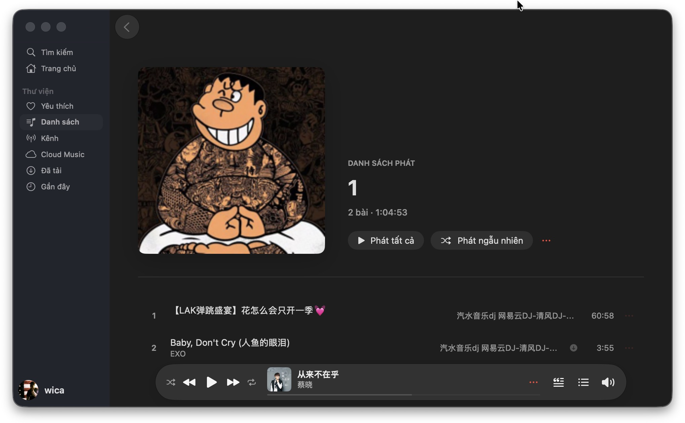
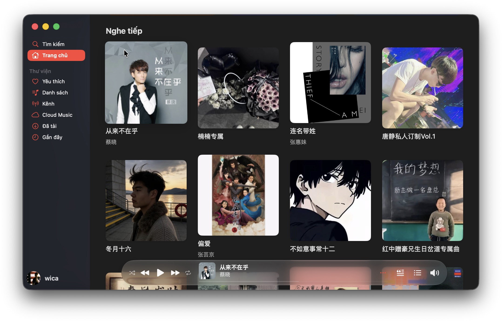
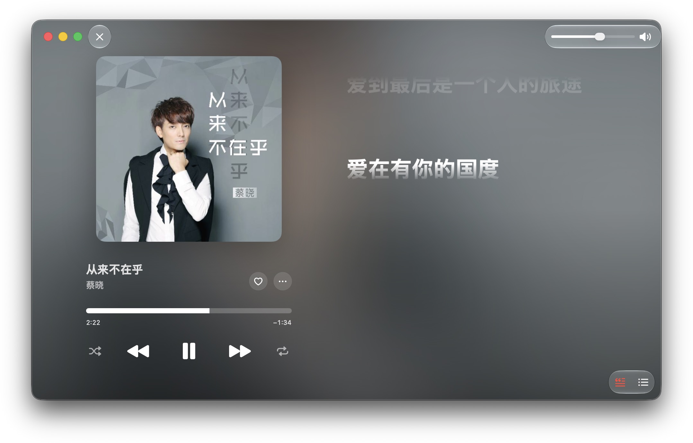
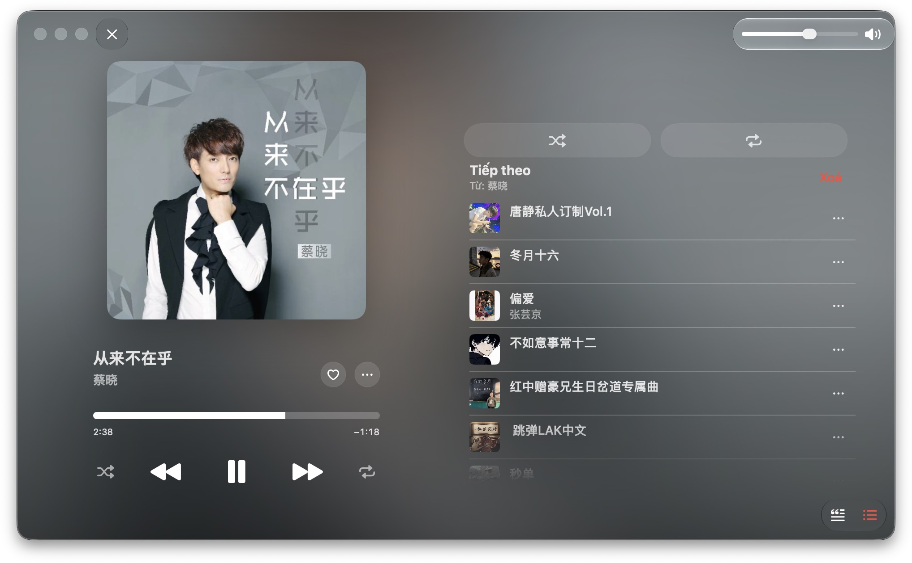
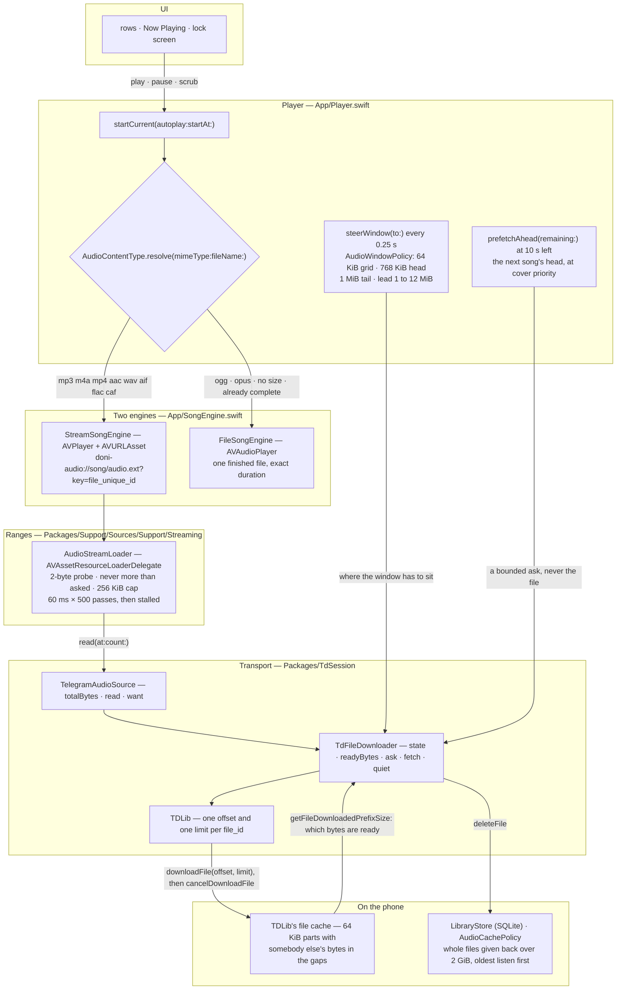
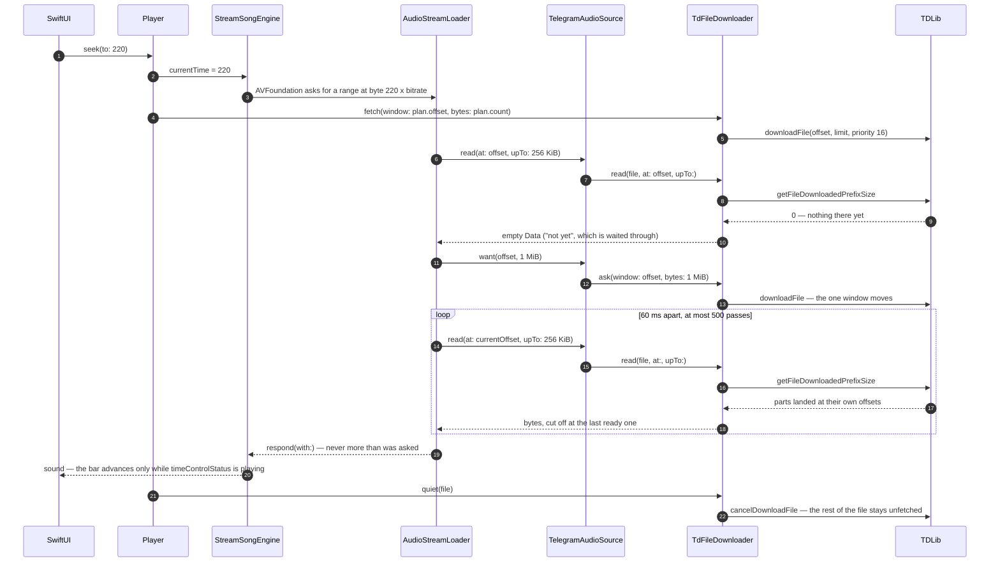

<div align="center">


# Doni

[English](../../README.md) · [Tiếng Việt](README.vi.md) · [中文](README.zh.md) · **Español** ·
[Français](README.fr.md) · [Русский](README.ru.md) · [العربية](README.ar.md)

<a href="https://github.com/williamcachamwri/Doni/releases/latest"></a>

<a href="https://developer.apple.com/swift/"></a>


</div>

Un reproductor de música para iPhone que toca lo que ya tienes en Telegram: los canales que sigues y
Saved Messages como biblioteca propia. Sin servidores detrás, sin registro, sin enviar datos a ningún lado.

### iOS

<table>
  <tr>
    <td></td>
    <td></td>
    <td></td>
    <td></td>
  </tr>
  <tr>
    <td align="center">Inicio.</td>
    <td align="center">Reproduciendo ahora.</td>
    <td align="center">La línea que se canta, en la pantalla de bloqueo.</td>
    <td align="center">Una lista que creaste.</td>
  </tr>
</table>

### macOS

<table>
  <tr>
    <td></td>
    <td></td>
    <td></td>
    <td></td>
  </tr>
  <tr>
    <td align="center">Lista de reproducción.</td>
    <td align="center">Inicio.</td>
    <td align="center">Reproduciendo ahora.</td>
    <td align="center">Cola de reproducción.</td>
  </tr>
</table>

## Qué hace

- **Empieza ya y descarga mientras suena.** El archivo se pide en rangos de bytes alrededor de la
  posición: saltar a 3:40 pide la parte de 3:40, no el archivo entero.
- **Recuerda lo que pidió.** Los trozos se quedan en el teléfono aunque mates la app. Lo que ya
  escuchaste completo funciona sin red.
- **Cloud Music es Saved Messages.** Subir un archivo lo manda a tu propio chat y borra la copia local;
  si lo borras en Telegram, desaparece de la app.
- **Letras con tiempo** de lrclib, NetEase, AMLL y QQ Music. El verso que suena ocupa el título en la
  pantalla de bloqueo y en la Dynamic Island.
- **Carátulas** de la etiqueta del archivo o de la miniatura de Telegram; si Telegram aún no la generó,
  se vuelve a pedir unas cuantas veces.
- **Caché con tope.** Tú fijas el límite (2 GiB por defecto); se liberan primero las canciones menos
  escuchadas y nunca la que está sonando.
- Seis idiomas en la interfaz; las cadenas del código están en vietnamita.

## Por qué Telegram

Porque la biblioteca ya está ahí. Cada canción es un mensaje con un archivo, y cada archivo lleva un
`file_unique_id` que significa los mismos bytes en cualquier base de datos. Así «¿ya la tengo?» y «¿por
dónde iba?» los resuelve el protocolo, no un servidor que yo tenga que mantener y que lea tus datos.
TDLib hace la red: acceso, reintentos, descargas, caché de archivos, redirecciones del CDN.

## Cómo es el streaming de verdad

Ninguna capa de ahí abajo pide el archivo entero. `Player` entrega a AVFoundation una URL con un
esquema de la propia app, AVFoundation pide rangos de bytes de esa URL, y cada respuesta se corta por
el último byte que TDLib confirma que ya está en el teléfono. El archivo entero solo se descarga
cuando el contenedor es uno que AVFoundation no puede decodificar, cuando TDLib todavía no sabe el
tamaño, o cuando el transporte dice que esos bytes no van a llegar.

- `downloadFile` acepta offset y límite, pero el límite no corta la descarga: TDLib responde con
  `ignore_download_limit` (`FileManager.cpp:3111`), así que el límite solo dice cuándo queda satisfecho
  *quien pregunta* y el archivo sigue bajando. Por eso cada ventana va seguida de un
  `cancelDownloadFile`. Cancelar no recupera nada: los trozos ya se escribieron en su propio offset
  (`FileDownloader.cpp:281`) y la máscara de preparación sigue contándolos.
- `getFileDownloadedPrefixSize` dice cuántos bytes hay listos en *cualquier* offset, no solo al
  principio. Es la máscara de preparación, no un «terminado o no», y es lo que hace útil un archivo a
  medias: volver a un punto que el teléfono ya leyó no cuesta red.
- TDLib guarda exactamente un offset por `file_id` (`FileManager.cpp:3103-3107`) y mueve la ventana de
  la descarga en marcha en vez de abrir una segunda. O sea que hay una ventana y dos sitios que deciden
  dónde: el loader dice dónde está el lector en cuanto una lectura vuelve vacía, y el reloj de un
  cuarto de segundo de la app planea dónde debe sentarse la ventana — se vuelve a pedir solo cuando se
  escuchó la mitad, porque pedirla cada cuarto de segundo cancela los trozos que estaban llegando.
- Los trozos miden 64 KiB y la ventana empieza en esa rejilla, porque un trozo solo se lee desde su
  principio y un offset impar compra bytes que ningún lector puede usar. Lo que está fuera de un rango
  listo son datos de otro archivo, y por eso al perder la red la música se detiene en lugar de emitir
  ruido.
- AVFoundation abre un flujo con una sonda de 2 bytes y rechaza una respuesta más larga de lo que pidió,
  y un resource loader no es una URL a la que pueda sondearle el formato: hay que entregarle el UTI del
  contenedor, o el fallo llega como -11850 «the server is not correctly configured», que suena a red
  rota y es una cadena que falta.

### Los niveles



Dos de esas aristas son todo el argumento: `downloadFile` siempre va seguido de `cancelDownloadFile`,
así que la descarga se detiene en la ventana en vez de arrastrarse hasta el final de un set de 166 MB;
y la lectura que responde a AVFoundation se corta en `getFileDownloadedPrefixSize`, así que un agujero
en medio del archivo se espera en lugar de leerse a través. La última arista es la otra mitad de la
promesa: los bytes que se quedan son lo que hace una canción reproducible sin red, y la barrida que los
devuelve nunca toca la canción bajo el cabezal — TDLib libera archivos enteros, así que uno a medias se
desaloja entero, nunca a medias.

### Qué cuesta arrastrar a 3:40



### Los números, y dónde vive cada uno

| Número | Dónde | Qué decide |
|---|---|---|
| 64 KiB | `AudioWindowPolicy.partBytes` | la rejilla de trozos de TDLib; cada ventana empieza en ella |
| 768 KiB | `AudioWindowPolicy.headBytes` | lo que pide un arranque: bastante para que el decodificador halle un borde de frame y informe duración |
| 1 MiB | `AudioWindowPolicy.tailBytes` | la petición extra para `m4a`/`mp4`/`aac`/`m4b`, cuyo `moov` está al final del archivo |
| 1 → 12 MiB | `minimumLeadBytes` … `maximumLeadBytes` | lo que la ventana le saca al cabezal: se duplica tras un rebuffer, se baja a la mitad cuando el búfer sobra al doble |
| 256 KiB | `AudioStreamLoader.chunkBytes` | la respuesta más larga que admite una petición |
| 1 MiB | `chunkBytes * 4` | hasta dónde manda el loader que llegue el transporte cuando una lectura vuelve vacía |
| 60 ms × 500 | `pollNanoseconds` · `maximumIdlePasses` | cuánto se espera un rango: medio minuto sin nada y lo llama stalled |
| 300 ms · 25 s | `TdFileDownloader.windowPoll` · `windowPatience` | cada cuánto mira la app si la ventana aterrizó, y cuándo concluye que no viene |
| 16 · 1 | `audioPriority` · `coverPriority` | el archivo del cabezal frente a las tapas y la próxima canción adivinada |
| 0,25 s | el reloj de `Player` | la posición, la instantánea de reanudación, la comprobación de prefetch y el timón de la ventana |
| 10 s | `Player.prefetchLead` | cuándo se pide la cabecera de la siguiente — solo la cabecera y nada más |
| 32 KiB · 64 KiB | `Library.probe` | lo que cuesta una duración cuando el mensaje no la trae: la cabecera, más el pie de un `mp4` no escrito para streaming |
| 2 GiB | `Library.defaultQuota` | el techo de la caché, y la vara con la que mide `AudioCachePolicy` |

## Compilar

Hace falta iOS 26, Xcode 26, [XcodeGen](https://github.com/yonaskolb/XcodeGen), CMake, Python 3 y un
`api_id`/`api_hash` de [my.telegram.org](https://my.telegram.org).

```sh
make vendor       # compila TDLib y OpenSSL (unos 20 min la primera vez)
make project      # genera Doni.xcodeproj
cp Config/Tdlib.example.xcconfig Config/Tdlib.xcconfig   # tus datos; el archivo no se sube
make build        # aviso es error
make device && make install
```

## Publicar

Una versión, dos números, los dos en `project.yml` y se cambian juntos. `MARKETING_VERSION` es la que
muestra «Información» y la que debe coincidir con la etiqueta; `CURRENT_PROJECT_VERSION` es el número de
compilación que lleva la misma versión en sus dígitos: `90 | mayor | menor | parche`, así que `9010000`
es 1.0.0. Las notas de versión se escriben una vez en `RELEASE_NOTES.md`, en dos idiomas y con igual
cantidad de líneas.

## Límites

- Firma con equipo gratuito: 3 dispositivos y certificado que muere a los 7 días.
- El IPA publicado no está firmado; hay que volver a firmarlo con tu equipo. `make release` lo compila aquí, etiqueta la versión, sube todo y adjunta el IPA; el workflow queda para ejecución manual desde Actions, como prueba de que compila en un checkout limpio.
- Sin CarPlay por ahora: hace falta el permiso `carplay-audio`, o sea cuenta de pago.
- Las letras vienen de fuentes públicas. Si nadie escribió la de una canción, la app lo dice en vez de
  mostrar una página vacía.
- Comprobar actualizaciones informa y abre la página de la versión; no instala nada.

## Licencia y créditos

GPL-3.0 ([LICENSE](../../LICENSE)): la pantalla de letras y varias vistas salen de
[MeloX](https://github.com/youshen2/MeloX), que es GPLv3. **TDLib** (BSL 1.0), **OpenSSL** (Apache-2.0),
**SQLite** para la biblioteca y las listas, y **Telegram-iOS** (GPL-2.0) solo para medir separaciones y
colores: no hay ni una línea de su código aquí.

Doni no está afiliado ni autorizado por Telegram ni por ninguna discográfica. Abre archivos que ya
están en tu cuenta.

Contacto: Telegram [@w1lliamcachamwri](https://t.me/w1lliamcachamwri) ·
[github.com/williamcachamwri/Doni](https://github.com/williamcachamwri/Doni)

