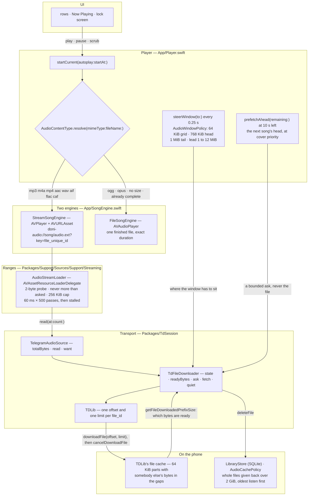
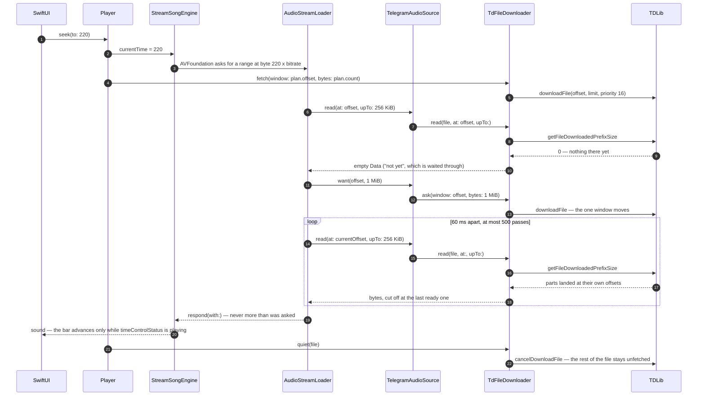

<div align="center">


# Doni

[English](../../README.md) · [Tiếng Việt](README.vi.md) · [中文](README.zh.md) · [Español](README.es.md) ·
**Français** · [Русский](README.ru.md) · [العربية](README.ar.md)

<a href="https://github.com/williamcachamwri/Doni/releases/latest"></a>

<a href="https://developer.apple.com/swift/"></a>


</div>

Un lecteur de musique pour iPhone qui joue les titres déjà présents dans votre Telegram : les chaînes
abonnées et Saved Messages comme bibliothèque personnelle. Pas de serveur, pas d'inscription, aucune
donnée envoyée.

<table>
  <tr>
    <td></td>
    <td></td>
    <td></td>
    <td></td>
  </tr>
</table>

## Ce qu'il fait

- **Démarrage immédiat, téléchargement pendant la lecture.** Le fichier est demandé par plages d'octets
  autour de la position : aller à 3:40 demande la partie autour de 3:40, pas le fichier entier.
- **Il garde ce qu'il a pris.** Les morceaux restent sur le téléphone même si l'app est tuée ; un titre
  déjà écouté en entier fonctionne hors réseau.
- **Cloud Music, c'est Saved Messages.** Téléverser un fichier l'envoie dans votre propre conversation
  puis supprime la copie locale ; supprimé dans Telegram, il disparaît aussi d'ici.
- **Paroles horodatées** via lrclib, NetEase, AMLL et QQ Music. Le verset en cours remplace le titre sur
  l'écran de verrouillage et dans la Dynamic Island.
- **Pochettes** prises dans les étiquettes du fichier ou la vignette de Telegram ; si Telegram ne l'a pas
  encore générée, la question est posée de nouveau quelques fois.
- **Cache plafonné.** Le quota vous appartient (2 GiB par défaut), les titres le moins écoutés partent en
  premier, jamais celui qui joue.
- Six langues dans l'interface ; les chaînes du code sont en vietnamien.

## Pourquoi Telegram

Parce que la bibliothèque existe déjà. Chaque titre est un message portant un fichier, chaque fichier a un
`file_unique_id` qui désigne les mêmes octets dans n'importe quelle base. « Ai-je déjà ce titre ? » et
« où m'étais-je arrêté ? » reçoivent une réponse du protocole plutôt que d'un serveur que je devrais
financer et qui lirait vos données. TDLib s'occupe du réseau : connexion, reprises, téléchargements,
cache de fichiers, redirections CDN.

## Le streaming, concrètement

Aucune couche en dessous ne demande le fichier entier. `Player` remet à AVFoundation une URL d'un
schéma qui appartient à l'app, AVFoundation demande des plages d'octets, et chaque réponse est coupée
au dernier octet que TDLib déclare prêt sur le téléphone. On ne télécharge tout que si le conteneur est
indécodable par AVFoundation, si TDLib ne connaît pas encore la taille, ou si le transport dit que ces
octets n'arriveront pas.

- `downloadFile` prend un décalage et une limite, mais la limite n'arrête rien : TDLib répond avec
  `ignore_download_limit` (`FileManager.cpp:3111`), donc la limite ne fixe que le moment où *celui qui
  demande* est servi, et le fichier continue de descendre. D'où un `cancelDownloadFile` derrière chaque
  fenêtre. Annuler ne reprend rien : les parts ont été écrites à leur propre décalage
  (`FileDownloader.cpp:281`) et le masque de préparation continue de les compter.
- `getFileDownloadedPrefixSize` indique combien d'octets sont prêts à *n'importe quel* décalage, pas
  seulement au début. C'est le masque de préparation, pas un drapeau « fini ou non », et c'est ce qui
  rend utile un fichier incomplet : revenir à un point que le téléphone a déjà lu ne coûte pas de réseau.
- TDLib ne tient qu'un seul décalage par `file_id` (`FileManager.cpp:3103-3107`) et déplace la fenêtre
  du téléchargement en cours au lieu d'en ouvrir un second. Une fenêtre donc, et deux endroits pour dire
  où elle doit être : le loader dit où en est le lecteur dès qu'une lecture revient vide, et le quart
  de seconde de l'app planifie la fenêtre — on ne la redemande qu'une fois la moitié écoutée, car la
  redemander quatre fois par seconde annule les parts qui arrivaient.
- Les parts font 64 KiB et la fenêtre démarre sur cette grille : une part ne se lit que depuis son
  début, donc un décalage de travers achète des octets qu'aucun lecteur ne peut utiliser. Hors plage
  prête, ce sont les données d'un autre fichier — voilà pourquoi une coupure réseau arrête la musique au
  lieu d'en faire sortir de la parasites.
- AVFoundation ouvre un flux par une sonde de 2 octets et refuse une réponse plus longue que sa demande,
  et un resource loader n'est pas une URL dont il puisse deviner le format : il faut lui donner l'UTI du
  conteneur, sinon l'erreur remonte en -11850 « the server is not correctly configured », qui ressemble
  à un réseau cassé et est une chaîne manquante.

### Les étages



Deux de ces arêtes sont l'argument tout entier : `downloadFile` est toujours suivi de
`cancelDownloadFile`, donc le téléchargement s'arrête à la fenêtre au lieu de traîner jusqu'au bout d'un
set de 166 Mo ; et la lecture qui répond à AVFoundation se coupe à `getFileDownloadedPrefixSize`, donc
un trou en plein fichier est attendu plutôt que lu à travers. La dernière arête est l'autre moitié de la
promesse : les octets qui restent rendent un titre rejouable sans réseau, et le balayage qui les rend ne
touche jamais le titre sous la tête de lecture — TDLib libère un fichier entier, donc un fichier à moitié
descendu part en entier, jamais en partie.

### Ce que coûte un bond à 3:40



### Les nombres, et où chacun habite

| Nombre | Où | Ce qu'il décide |
|---|---|---|
| 64 KiB | `AudioWindowPolicy.partBytes` | la grille de parts de TDLib ; chaque fenêtre y commence |
| 768 KiB | `AudioWindowPolicy.headBytes` | ce que demande un départ : assez pour que le décodeur trouve une frontière trame et annonce la durée |
| 1 MiB | `AudioWindowPolicy.tailBytes` | la demande en plus pour `m4a`/`mp4`/`aac`/`m4b`, dont le `moov` est en fin de fichier |
| 1 → 12 MiB | `minimumLeadBytes` … `maximumLeadBytes` | l'avance prise sur la tête de lecture : doublée après un réamorçage, réduite de moitié quand la réserve a deux fois plus que besoin |
| 256 KiB | `AudioStreamLoader.chunkBytes` | la réponse la plus longue qu'une requête obtienne |
| 1 MiB | `chunkBytes * 4` | jusqu'où le loader dit au transport d'aller quand une lecture revient vide |
| 60 ms × 500 | `pollNanoseconds` · `maximumIdlePasses` | combien de temps on attend une plage — une demi-minute sans rien et elle est dite stalled |
| 300 ms · 25 s | `TdFileDownloader.windowPoll` · `windowPatience` | à quelle fréquence l'app regarde la fenêtre atterrir, et quand elle conclut qu'elle ne vient pas |
| 16 · 1 | `audioPriority` · `coverPriority` | le fichier sous la tête de lecture face aux pochettes et au titre suivant deviné |
| 0,25 s | l'horloge de `Player` | la position, l'instantané de reprise, la vérification de prefetch et le pilotage de la fenêtre |
| 10 s | `Player.prefetchLead` | quand on va chercher la tête du titre suivant — sa tête et rien de plus |
| 32 KiB · 64 KiB | `Library.probe` | ce que coûte une durée quand le message n'en porte pas : la tête, plus la queue d'un `mp4` non écrit pour le streaming |
| 2 GiB | `Library.defaultQuota` | le plafond du cache, et l'aune à laquelle `AudioCachePolicy` se mesure |

## Compiler

Il faut iOS 26, Xcode 26, [XcodeGen](https://github.com/yonaskolb/XcodeGen), CMake, Python 3 et un
`api_id`/`api_hash` de [my.telegram.org](https://my.telegram.org).

```sh
make vendor       # compile TDLib et OpenSSL (une vingtaine de minutes)
make project      # génère Doni.xcodeproj
cp Config/Tdlib.example.xcconfig Config/Tdlib.xcconfig   # vos valeurs, fichier non publié
make build        # un avertissement est une erreur
make device && make install
```

## Publier

Une version, deux numéros, tous deux dans `project.yml`, à changer ensemble. `MARKETING_VERSION` est
celle qu'affiche « À propos » et que doit porter l'étiquette ; `CURRENT_PROJECT_VERSION` est le numéro de
compilation qui encode la même version : `90 | majeur | mineur | correctif`, donc `9010000` vaut 1.0.0.
Les notes de version s'écrivent une fois dans `RELEASE_NOTES.md`, en deux langues et en même nombre de
lignes.

## Limites

- Signature en équipe gratuite : 3 appareils, certificat mort au bout de 7 jours.
- L'IPA publié n'est pas signé ; il faut le resigner avec votre équipe. `make release` le compile ici, étiquette la version, pousse et joint l'IPA ; le workflow reste en déclenchement manuel depuis Actions, pour prouver que la compile marche sur un checkout propre.
- Pas de CarPlay pour l'instant : l'autorisation `carplay-audio` exige un compte payant.
- Les paroles viennent de sources publiques ; un titre que personne n'a retranscrit n'a pas de paroles, et
  l'app le dit au lieu d'afficher une page vide.
- La vérification de mise à jour prévient et ouvre la page de publication ; elle n'installe rien.

## Licence et crédits

GPL-3.0 ([LICENSE](../../LICENSE)) : l'écran des paroles et plusieurs vues viennent de
[MeloX](https://github.com/youshen2/MeloX), qui est GPLv3. **TDLib** (BSL 1.0), **OpenSSL** (Apache-2.0),
**SQLite** pour la bibliothèque et les listes, **Telegram-iOS** (GPL-2.0) uniquement pour mesurer espacements
et couleurs — aucune ligne de son code ici.

Doni n'est affilié ni autorisé par Telegram ou un quelconque service de musique. Il ouvre des fichiers déjà
dans votre compte.

Contact : Telegram [@w1lliamcachamwri](https://t.me/w1lliamcachamwri) ·
[github.com/williamcachamwri/Doni](https://github.com/williamcachamwri/Doni)

