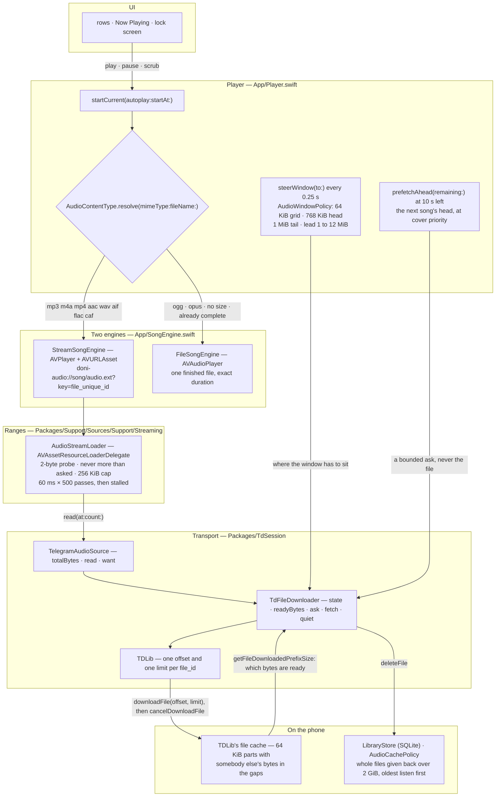
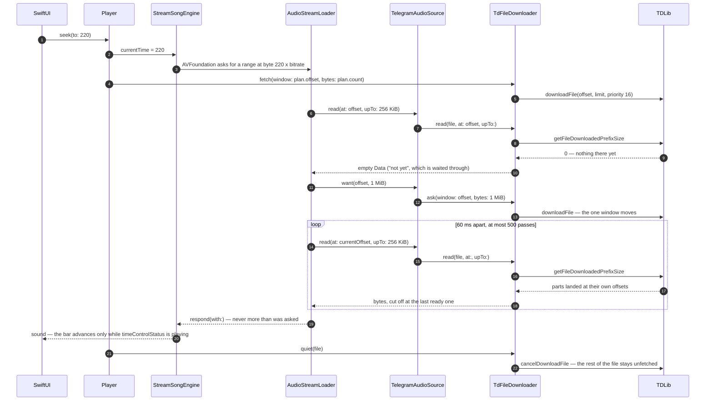

<div align="center">


# Doni

[English](../../README.md) · [Tiếng Việt](README.vi.md) · [中文](README.zh.md) · [Español](README.es.md) ·
[Français](README.fr.md) · **Русский** · [العربية](README.ar.md)

<a href="https://github.com/williamcachamwri/Doni/releases/latest"></a>

<a href="https://developer.apple.com/swift/"></a>


</div>

Музыкальный плеер для iPhone, который играет то, что уже лежит в вашем Telegram: каналы, на которые вы
подписаны, и Saved Messages как личная фонотека. Никакого сервера, никакой регистрации, ничего никуда не
отправляется.

### iOS

<table>
  <tr>
    <td></td>
    <td></td>
    <td></td>
    <td></td>
  </tr>
  <tr>
    <td align="center">Главная.</td>
    <td align="center">Сейчас играет.</td>
    <td align="center">Строка текста на экране блокировки.</td>
    <td align="center">Созданный вами список.</td>
  </tr>
</table>

### macOS

<table>
  <tr>
    <td></td>
    <td></td>
    <td></td>
    <td></td>
  </tr>
  <tr>
    <td align="center">Плейлист.</td>
    <td align="center">Главная.</td>
    <td align="center">Сейчас играет.</td>
    <td align="center">Очередь воспроизведения.</td>
  </tr>
</table>

## Что умеет

- **Начинает сразу и докачивает на ходу.** Файл берётся байтовыми диапазонами вокруг позиции: перемотка
  на 3:40 просит кусок около 3:40, а не весь файл.
- **Помит, что уже взял.** Куски остаются в телефоне даже после убийтия приложения; дослушанное
  воспроизводится без сети.
- **Cloud Music — это Saved Messages.** Загрузка отправляет файл в ваш собственный чат и удаляет локальную
  копию; удалили в Telegram — исчезло и отсюда.
- **Тексты с таймингом** из lrclib, NetEase, AMLL и QQ Music. Строка, которую сейчас поют, заменяет
  название на экране блокировки и в Dynamic Island.
- **Обложки** из тегов самого файла или из миниатюры Telegram; если Telegram ещё не сгенерировал её,
  приложение переспрашивает несколько раз.
- **Кэш с потолком.** Квоту выбираете вы (по умолчанию 2 GiB); освобождают сначала самое непрослушанное,
  играющий трек не вычищается никогда.
- Шесть языков интерфейса; исходные строки в коде вьетнамские.

## Почему Telegram

Потому что фонотека уже там. Каждый трек — сообщение с файлом, у каждого файла есть `file_unique_id`,
означающий те же байты в любой базе. Поэтому «есть ли этот трек» и «на чём я остановился» отвечает
протокол, а не сервер, который мне пришлось бы содержать и который читал бы ваши данные. Сетью заведует
TDLib: вход, повторы, загрузки, файловый кэш, редиректы CDN.

## Как устроен стриминг

Ни один слой ниже не просит файл целиком. `Player` отдаёт AVFoundation URL со схемой самого
приложения, AVFoundation спрашивает диапазоны байт, и каждый ответ обрезается по последний байт,
который TDLib объявил готовым на телефоне. Целиком файл качается только в трёх случаях: контейнер, не
декодируемый AVFoundation; TDLib ещё не знает размер; транспорт сказал, что эти байты не придут.

- `downloadFile` принимает смещение и лимит, но лимит не ограничивает загрузку: TDLib отвечает через
  `ignore_download_limit` (`FileManager.cpp:3111`), поэтому лимит решает лишь то, когда удовлетворён
  *спрашивающий*, а файл продолжает качаться. За каждым окном следует `cancelDownloadFile`. Отмена
  ничего не отбирает: части уже записаны по своим смещениям (`FileDownloader.cpp:281`), и маска
  готовности продолжает их считать.
- `getFileDownloadedPrefixSize` отвечает, сколько байт готово при *любом* смещении, а не только в
  начале. Это маска готовности, а не флаг «закончено или нет», и именно из-за неё неполный файл полезен:
  перемотка назад, в место, которое телефон уже читал, сети не стоит.
- TDLib держит ровно одно смещение на `file_id` (`FileManager.cpp:3103-3107`) и двигает окно уже идущей
  загрузки, а не открывает вторую. Значит окно одно, а решают, где ему быть, двое: loader говорит, где
  читатель, как только чтение вернулось пустым, и четвертьсекундный такт приложения планирует окно —
  переспрашивают, только когда прослушана примерно половина окна, потому что переспрашивать каждые
  четверть секунды значит отменять собственные прибывающие части.
- Части по 64 КиБ, и окно начинается на этой сетке: часть читается только с её начала, поэтому
  несовпавшее смещение покупает байты, которые нечем прочитать. Байты вне готового диапазона — данные
  другого файла, поэтому при обрыве сети музыка останавливается, а не шипит.
- AVFoundation открывает поток пробником в 2 байта и отвергает ответ длиннее запрошенного, а resource
  loader — не URL, из которого можно вынюхать формат: UTI контейнера надо передать, иначе ошибка придёт
  как -11850 «the server is not correctly configured», что похоже на сломанную сеть, а на деле
  пропущена строка.

### Уровни



Два последних ребра — весь довод: за `downloadFile` всегда следует `cancelDownloadFile`, поэтому
загрузка останавливается на окне, а не дотягивается до конца сета на 166 МБ; и чтение, отвечающее
AVFoundation, обрезается по `getFileDownloadedPrefixSize`, поэтому дыра посередине файла дожидается, а
не прочитывается насквозь. Последнее ребро — вторая половина обещания: оставшиеся байты и делают трек
воспроизводимым без сети, а sweep, который их освобождает, никогда не трогает трек под головкой — TDLib
освобождает файл целиком, поэтому докачанный наполовину выбрасывается целиком.

### Что стоит перемотка на 3:40



### Числа и где каждое из них живёт

| Число | Где | Что решает |
|---|---|---|
| 64 KiB | `AudioWindowPolicy.partBytes` | сетка частей TDLib; каждое окно начинается с неё |
| 768 KiB | `AudioWindowPolicy.headBytes` | сколько просит старт: довольно, чтобы декодер нашёл границу кадра и назвал длительность |
| 1 MiB | `AudioWindowPolicy.tailBytes` | дополнительная просьба для `m4a`/`mp4`/`aac`/`m4b`, у которых `moov` в конце файла |
| 1 → 12 MiB | `minimumLeadBytes` … `maximumLeadBytes` | насколько окно опережает головку: удваивается после ребуфера, уменьшается вдвое, когда буфера больше чем вдвое нужного |
| 256 KiB | `AudioStreamLoader.chunkBytes` | самый длинный ответ на один запрос |
| 1 MiB | `chunkBytes * 4` | как далеко велит послать транспорт loader, когда чтение вернулось пустым |
| 60 ms × 500 | `pollNanoseconds` · `maximumIdlePasses` | сколько ждут диапазон — полминуты ничего, и это называется stalled |
| 300 ms · 25 s | `TdFileDownloader.windowPoll` · `windowPatience` | как часто приложение смотрит, село ли окно, и когда решает, что оно не сядет |
| 16 · 1 | `audioPriority` · `coverPriority` | файл под головкой против обложек и угаданного следующего трека |
| 0,25 s | такт `Player` | позиция, снимок для продолжения, проверка prefetch и рулёжка окном |
| 10 s | `Player.prefetchLead` | когда берётся голова следующего трека — только голова и ничего больше |
| 32 KiB · 64 KiB | `Library.probe` | сколько стоит длительность, когда сообщение её не несёт: голова плюс хвост для `mp4`, не записанного под стриминг |
| 2 GiB | `Library.defaultQuota` | потолок кэша и мера, относительно которой работает `AudioCachePolicy` |

## Сборка

Нужны iOS 26, Xcode 26, [XcodeGen](https://github.com/yonaskolb/XcodeGen), CMake, Python 3 и
`api_id`/`api_hash` с [my.telegram.org](https://my.telegram.org).

```sh
make vendor       # собирает TDLib и OpenSSL (первый раз около 20 минут)
make project      # создаёт Doni.xcodeproj
cp Config/Tdlib.example.xcconfig Config/Tdlib.xcconfig   # свои значения, файл не публикуется
make build        # предупреждение равно ошибке
make device && make install
```

## Релиз

Одна версия — два числа, оба в `project.yml`, меняются вместе. `MARKETING_VERSION` показывает «О
приложении» и её обязан носить тег; `CURRENT_PROJECT_VERSION` — номер сборки, в котором зашита та же
версия: `90 | major | minor | patch`, то есть `9010000` это 1.0.0. Заметки к релизу пишутся один раз в
`RELEASE_NOTES.md`, на двух языках и равным числом строк.

## Ограничения

- Бесплатная команда: 3 устройства, сертификат живёт 7 дней.
- Выпускаемый IPA не подписан: ставить его можно только переподписав своей командой. `make release` собирает его здесь, ставит тег, пушит и прикладывает к релизу; workflow остаётся ручным запуском из Actions — проверить, что сборка проходит с чистой копии.
- CarPlay пока нет: нужно разрешение `carplay-audio`, а значит платный аккаунт.
- Тексты берутся из открытых источников; если песни никто не расшифровал, приложение так и скажет, а не
  покажет пустую страницу.
- Проверка обновлений только сообщает о новой версии и открывает страницу релиза — сама ничего не ставит.

## Лицензия и благодарность

GPL-3.0 ([LICENSE](../../LICENSE)): экран текстов и несколько видов взяты из
[MeloX](https://github.com/youshen2/MeloX), который GPLv3. **TDLib** (BSL 1.0), **OpenSSL** (Apache-2.0),
**SQLite** для фонотеки и плейлистов, **Telegram-iOS** (GPL-2.0) только как источник замеров отступов и
цветов — ни одной строки кода оттуда здесь нет.

Doni не связан с Telegram и не авторизован им или какой-либо музыкальной сервисом. Он открывает файлы,
которые уже лежат в вашем аккаунте.

Контакт: Telegram [@w1lliamcachamwri](https://t.me/w1lliamcachamwri) ·
[github.com/williamcachamwri/Doni](https://github.com/williamcachamwri/Doni)

