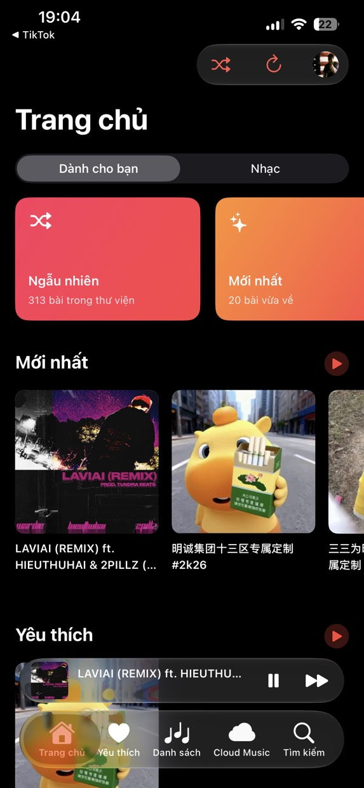
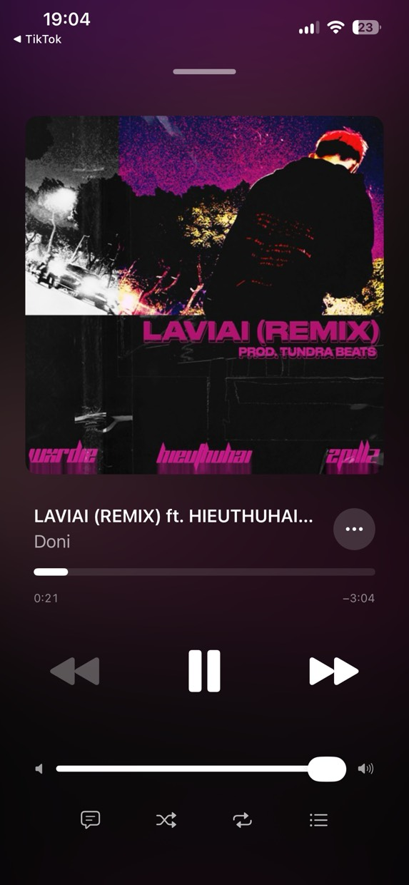
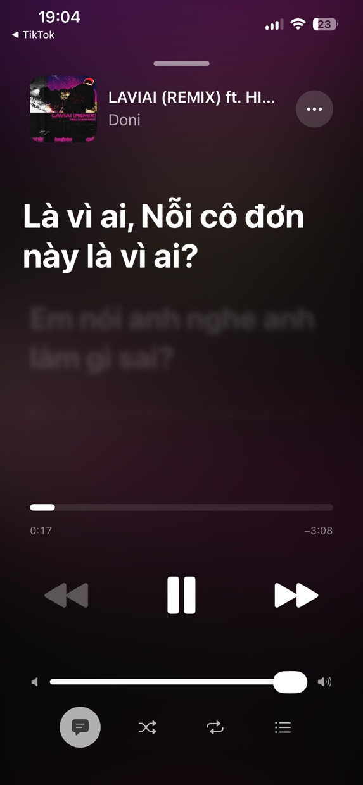
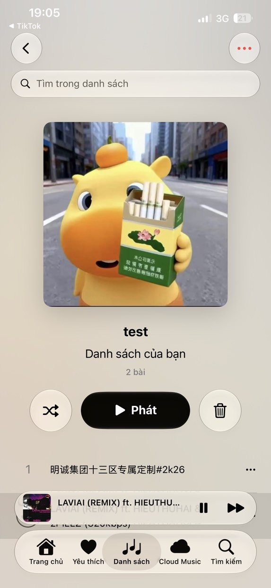

# Doni

[English](../../README.md) · [Tiếng Việt](README.vi.md) · [中文](README.zh.md) · [Español](README.es.md) ·
[Français](README.fr.md) · **Русский** · [العربية](README.ar.md)


Музыкальный плеер для iPhone, который играет то, что уже лежит в вашем Telegram: каналы, на которые вы
подписаны, и Saved Messages как личная фонотека. Никакого сервера, никакой регистрации, ничего никуда не
отправляется.

<table>
  <tr>
    <td></td>
    <td></td>
    <td></td>
    <td></td>
  </tr>
</table>

## Что умеет

- **Начинает сразу и докачивает на ходу.** Файл берётся байтовыми диапазонами вокруг позиции: перемотка
  на 3:40 просит кусок около 3:40, а не весь файл.
- **Помит, что уже взял.** Куски остаются в телефоне даже после убийтия приложения; дослушанное
  воспроизводится без сети.
- **Cloud Music — это Saved Messages.** Загрузка отправляет файл в ваш собственный чат и удаляет локальную
  копию; удалили в Telegram — исчезло и отсюда.
- **Тексты с таймингом** из lrclib, NetEase, AMLL и QQ Music. Строка, которую сейчас поют, заменяет
  название на экране блокировки и в Dynamic Island.
- **Обложки** из тегов самого файла или из миниатюры Telegram; если Telegram ещё не сгенерировал её,
  приложение переспрашивает несколько раз.
- **Кэш с потолком.** Квоту выбираете вы (по умолчанию 2 GiB); освобождают сначала самое непрослушанное,
  играющий трек не вычищается никогда.
- Шесть языков интерфейса; исходные строки в коде вьетнамские.

## Почему Telegram

Потому что фонотека уже там. Каждый трек — сообщение с файлом, у каждого файла есть `file_unique_id`,
означающий те же байты в любой базе. Поэтому «есть ли этот трек» и «на чём я остановился» отвечает
протокол, а не сервер, который мне пришлось бы содержать и который читал бы ваши данные. Сетью заведует
TDLib: вход, повторы, загрузки, файловый кэш, редиректы CDN.

## Как устроен стриминг

- `downloadFile` принимает смещение и лимит, но лимит не ограничивает загрузку: TDLib качает до отмены,
  поэтому окно закрывает само приложение.
- `getFileDownloadedPrefixSize` отвечает, сколько байт готово при *любом* смещении. Это маска
  готовности, а не флаг «закончено или нет», и именно из-за неё неполный файл полезен.
  Части по 64 КиБ; окно держится на несколько мегабайт впереди и сдвигается, когда половина израсходована.
- AVFoundation выпрашивает байты через `AVAssetResourceLoaderDelegate`, открывает файл пробником в 2 байта
  и отвергает ответ длиннее запрошенного.
- Байты вне готового окна — мусор. В декодер ничего не попадает без подтверждения TDLib, поэтому при
  обрыве сети музыка останавливается, а не шипит.

## Сборка

Нужны iOS 26, Xcode 26, [XcodeGen](https://github.com/yonaskolb/XcodeGen), CMake, Python 3 и
`api_id`/`api_hash` с [my.telegram.org](https://my.telegram.org).

```sh
make vendor       # собирает TDLib и OpenSSL (первый раз около 20 минут)
make project      # создаёт Doni.xcodeproj
cp Config/Tdlib.example.xcconfig Config/Tdlib.xcconfig   # свои значения, файл не публикуется
make build        # предупреждение равно ошибке
make device && make install
```

## Релиз

Одна версия — два числа, оба в `project.yml`, меняются вместе. `MARKETING_VERSION` показывает «О
приложении» и её обязан носить тег; `CURRENT_PROJECT_VERSION` — номер сборки, в котором зашита та же
версия: `90 | major | minor | patch`, то есть `9010000` это 1.0.0. Заметки к релизу пишутся один раз в
`RELEASE_NOTES.md`, на двух языках и равным числом строк.

## Ограничения

- Бесплатная команда: 3 устройства, сертификат живёт 7 дней.
- IPA из CI не подписан: ставить придётся после переподписи своей командой.
- CarPlay пока нет: нужно разрешение `carplay-audio`, а значит платный аккаунт.
- Тексты берутся из открытых источников; если песни никто не расшифровал, приложение так и скажет, а не
  покажет пустую страницу.
- Проверка обновлений только сообщает о новой версии и открывает страницу релиза — сама ничего не ставит.

## Лицензия и благодарность

GPL-3.0 ([LICENSE](../../LICENSE)): экран текстов и несколько видов взяты из
[MeloX](https://github.com/youshen2/MeloX), который GPLv3. **TDLib** (BSL 1.0), **OpenSSL** (Apache-2.0),
**SQLite** для фонотеки и плейлистов, **Telegram-iOS** (GPL-2.0) только как источник замеров отступов и
цветов — ни одной строки кода оттуда здесь нет.

Doni не связан с Telegram и не авторизован им или какой-либо музыкальной сервисом. Он открывает файлы,
которые уже лежат в вашем аккаунте.

Контакт: Telegram [@w1lliamcachamwri](https://t.me/w1lliamcachamwri) ·
[github.com/williamcachamwri/Doni](https://github.com/williamcachamwri/Doni)

