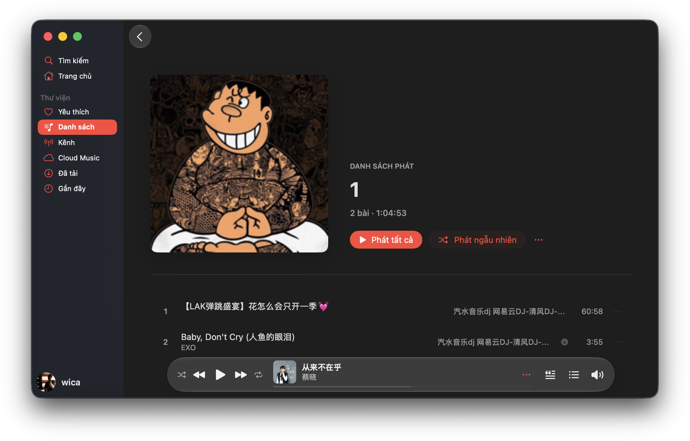
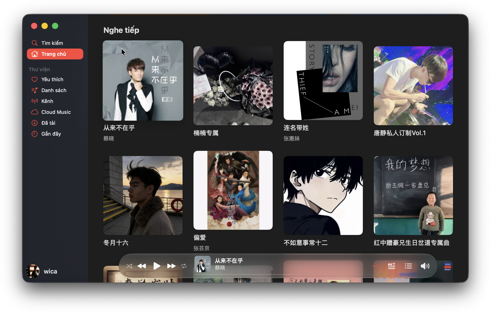
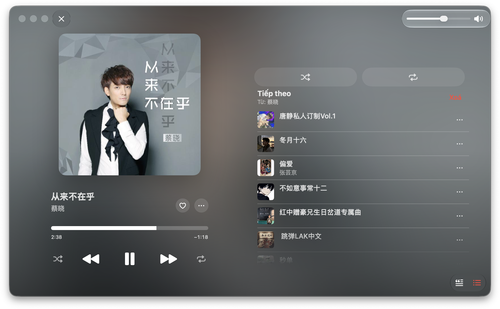
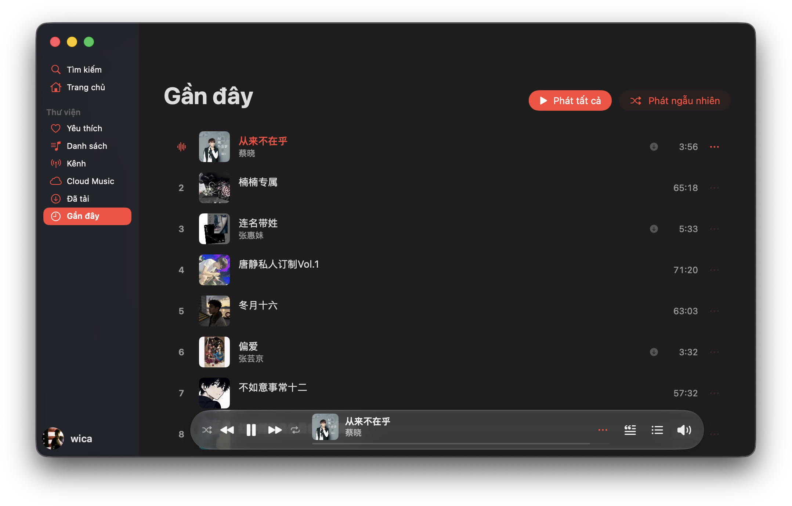
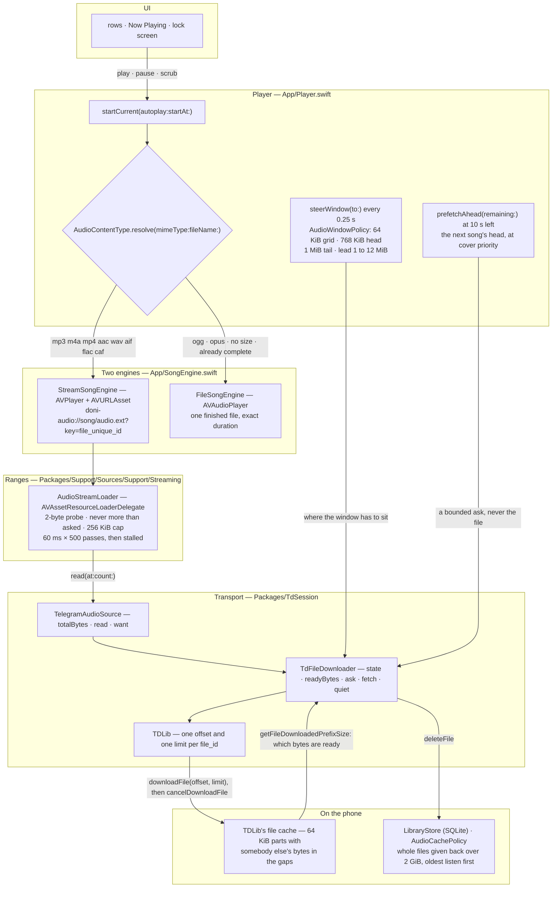
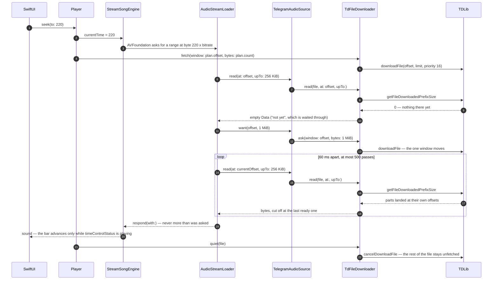

<div align="center">


# Doni

[English](../../README.md) · **Tiếng Việt** · [中文](README.zh.md) · [Español](README.es.md) ·
[Français](README.fr.md) · [Русский](README.ru.md) · [العربية](README.ar.md)

<a href="https://github.com/williamcachamwri/Doni/releases/latest"></a>

<a href="https://developer.apple.com/swift/"></a>


</div>

Máy nghe nhạc cho iPhone, phát những bài đã có sẵn trong Telegram của bạn: kênh bạn theo dõi, và
Saved Messages như thư viện riêng. Không có máy chủ đứng sau, không đăng ký tài khoản, không gửi số
liệu đi đâu.

### iOS

<table>
  <tr>
    <td></td>
    <td></td>
    <td></td>
    <td></td>
  </tr>
  <tr>
    <td align="center">Trang chủ.</td>
    <td align="center">Đang phát.</td>
    <td align="center">Dòng đang hát trên màn hình khoá.</td>
    <td align="center">Danh sách bạn tạo.</td>
  </tr>
</table>

### macOS

<table>
  <tr>
    <td></td>
  </tr>
  <tr>
    <td align="center">Danh sách phát.</td>
  </tr>
  <tr>
    <td></td>
  </tr>
  <tr>
    <td align="center">Trang chủ.</td>
  </tr>
  <tr>
    <td></td>
  </tr>
  <tr>
    <td align="center">Đang phát.</td>
  </tr>
  <tr>
    <td></td>
  </tr>
  <tr>
    <td align="center">Gần đây.</td>
  </tr>
</table>

## Nó làm gì

- **Bắt đầu ngay, vừa phát vừa tải.** Bài hát được lấy theo dải byte quanh vị trí đang nghe, nên tua
  tới 3:40 chỉ xin phần quanh 3:40 chứ không tải cả file.
- **Nhớ những gì đã tải.** Các mẩu ở lại trên máy kể cả khi app bị tắt khỏi switcher. Bài đã nghe hết
  thì nghe lại được khi mất mạng.
- **Cloud Music chính là Saved Messages.** Tải file lên là gửi vào chat của chính bạn rồi xoá bản trên
  máy; xoá trong Telegram thì bài đó cũng rời khỏi app.
- **Lời khớp thời gian** từ lrclib, NetEase, AMLL và QQ Music. Dòng đang hát thay tên bài trên màn hình
  khoá và Dynamic Island.
- **Ảnh bìa** lấy từ tag trong file hoặc thumbnail của Telegram; Telegram chưa tạo xong thì hỏi lại vài lần.
- **Cache có trần.** Bạn chọn hạn mức (mặc định 2 GiB), bài nghe ít nhất bị dọn trước, bài đang nghe
  không bao giờ bị xoá.
- Giao diện có sáu ngôn ngữ; chuỗi trong code là tiếng Việt.

## Vì sao là Telegram

Vì thư viện đã nằm ở đó. Mỗi bài là một message mang theo một file, và mỗi file có `file_unique_id`
nghĩa là cùng một dòng byte ở mọi database — nên "bài này đã có chưa" và "dừng ở đâu" do giao thức trả
lời, không cần một máy chủ mà tôi phải nuôi và phải đọc tin của bạn.

TDLib lo phần mạng: đăng nhập, thử lại, tải file, cache, chuyển hướng CDN. Doni lo phần mà không ai
quyết hộ được.

## Streaming thật diễn ra thế nào

Không tầng nào dưới đó xin cả một file. `Player` đưa cho AVFoundation một URL theo scheme riêng
của app, AVFoundation hỏi dải byte trên URL đó, và mọi câu trả lời bị cắt ở byte cuối cùng mà
TDLib xác nhận là đã có trên máy. Chỉ tải trọn file khi container mà AVFoundation không giải mã
được, khi TDLib chưa biết kích thước, hoặc khi phía truyền nói mấy byte ấy sẽ không tới.

- `downloadFile` nhận offset và limit, nhưng limit không chặn nổi việc tải: TDLib trả lời với
  `ignore_download_limit` (`FileManager.cpp:3111`), nên limit chỉ định lúc *bên hỏi* được đáp còn
  file thì vẫn tải tiếp. Vì vậy sau mỗi cửa sổ là một `cancelDownloadFile`. Huỷ không lấy lại gì:
  các mẩu đã được ghi đúng offset của chúng (`FileDownloader.cpp:281`) và bitmask sẵn sàng vẫn đếm
  tiếp.
- `getFileDownloadedPrefixSize` trả số byte đã sẵn sàng ở *mọi* offset chứ không riêng đầu file.
  Đó là ready bitmask, không phải cờ "xong chưa", và nó là lý do một file tải dở vẫn dùng được:
  tua lại chỗ mà máy đã đọc thì không tốn mạng.
- TDLib giữ đúng một offset cho mỗi `file_id` (`FileManager.cpp:3103-3107`) và dịch cửa sổ của lượt
  tải đang chạy chứ không mở lượt thứ hai. Nên chỉ có một cửa sổ và hai nơi quyết nó nằm đâu: loader
  nói bên đọc đang ở đâu ngay khi một lần read trả về không có gì, còn nhịp 0,25 s của app tính cửa sổ nên
  nằm đâu — và chỉ hỏi lại khi khoảng nửa cửa sổ đã nghe xong, vì hỏi lại mọi phần tư giây là tự
  cancel những mẩu đang tới.
- Mẩu có kích thước 64 KiB và cửa sổ bắt đầu trên lưới đó, vì một mẩu chỉ đọc được từ đầu của nó;
  offset lệch một byte mua về những byte không reader nào dùng được. Byte nằm ngoài dải sẵn sàng là
  dữ liệu của file khác — đó là lý do mất mạng thì nhạc dừng lại chứ không phát nhiễu.
- AVFoundation mở stream bằng một probe 2 byte và từ chối trả lời dài hơn chỗ nó xin; mà resource
  loader thì không phải một URL để nó tự dò format, nên phải đưa UTI của container, bằng không lỗi về
  là -11850 "the server is not correctly configured" — trông như mạng hỏng nhưng thật ra là thiếu
  một chuỗi.

### Các tầng



Hai cạnh cuối là toàn bộ lập luận: `downloadFile` luôn đi kèm `cancelDownloadFile`, nên lượt tải dừng
ở cửa sổ thay vì tải nốt một set 166 MB; và lần read trả lời AVFoundation bị cắt theo
`getFileDownloadedPrefixSize`, nên một lỗ thủng giữa file được chờ chứ không bị đọc xuyên qua. Cạnh
cuối là nửa còn lại của lời hứa: phần byte ở lại là thứ khiến một bài nghe lại được khi mất mạng, và
vòng dọn không bao giờ đụng bài đang phát — TDLib chỉ thu hồi cả file, nên file tải dở bị xoá nguyên
vẹn chứ không xoá một phần.

### Một cú tua tới 3:40 tốn gì



### Các con số, và mỗi số nằm ở đâu

| Số | Ở đâu | Nó quyết định gì |
|---|---|---|
| 64 KiB | `AudioWindowPolicy.partBytes` | lưới mẩu của TDLib; mọi cửa sổ đều bắt đầu trên lưới đó |
| 768 KiB | `AudioWindowPolicy.headBytes` | lượng mà một lần bắt đầu xin: đủ để decoder tìm ranh giới khung và báo độ dài |
| 1 MiB | `AudioWindowPolicy.tailBytes` | phần xin thêm cho `m4a`/`mp4`/`aac`/`m4b`, những file có `moov` ở cuối file |
| 1 → 12 MiB | `minimumLeadBytes` … `maximumLeadBytes` | cửa sổ dẫn trước đầu phát bao xa: nhân đôi sau một lần cạn buffer, giảm nửa khi buffer dư hơn hai lần mức cần |
| 256 KiB | `AudioStreamLoader.chunkBytes` | câu trả lời dài nhất mà một request được nhận |
| 1 MiB | `chunkBytes * 4` | loader bảo phía truyền với tới đâu khi một lần read trả về rỗng |
| 60 ms × 500 | `pollNanoseconds` · `maximumIdlePasses` | chờ một dải bao lâu — nửa phút không có gì thì bị gọi là stalled |
| 300 ms · 25 s | `TdFileDownloader.windowPoll` · `windowPatience` | app nhìn cửa sổ hạ xuống thường xuyên cỡ nào, và khi nào nó kết luận là cửa sổ không tới |
| 16 · 1 | `audioPriority` · `coverPriority` | file ở đầu phát so với ảnh bìa và bài kế tiếp chỉ mới đoán |
| 0,25 s | ticker của `Player` | vị trí, snapshot để nghe tiếp, việc kiểm tra prefetch và việc lái cửa sổ |
| 10 s | `Player.prefetchLead` | lúc nào lấy đầu của bài kế tiếp — chỉ đầu chứ không hơn |
| 32 KiB · 64 KiB | `Library.probe` | độ dài tốn gì khi message không mang theo: phần đầu, cộng phần đuôi cho `mp4` không viết để stream |
| 2 GiB | `Library.defaultQuota` | trần của cache, và mốc mà `AudioCachePolicy` đo vào |

## Build

Cần iOS 26, Xcode 26, [XcodeGen](https://github.com/yonaskolb/XcodeGen), CMake, Python 3 và
`api_id`/`api_hash` từ [my.telegram.org](https://my.telegram.org).

```sh
make vendor       # biên dịch TDLib + OpenSSL thành XCFramework (~20 phút lần đầu)
make project      # sinh Doni.xcodeproj từ project.yml
cp Config/Tdlib.example.xcconfig Config/Tdlib.xcconfig
# điền api_id, api_hash, team id — file này đã gitignore, chỉ nằm ở máy bạn
make build        # cổng compile: warning là lỗi
make device       # compile và ký cho iPhone của bạn
make install      # cài qua cáp
```

## Phát hành

Một phiên bản, hai số, cả hai trong `project.yml` và phải đổi cùng nhau: `MARKETING_VERSION` là thứ
About hiển thị và tag phải khớp; `CURRENT_PROJECT_VERSION` là số build mang đúng phiên bản trong các
chữ số — `90 | major | minor | patch`, nên `9010000` là 1.0.0.

Nhật ký cập nhật viết một lần trong `RELEASE_NOTES.md`, hai ngôn ngữ cùng số dòng; `make notes` sinh
JSON cho app và markdown cho release.

```sh
make notes      # RELEASE_NOTES.md → JSON cho app + nội dung release
make release    # build ở máy, tag đúng phiên bản, push, tạo release kèm IPA
```

`make release` chạy `Scripts/build-unsigned-ipa.sh`, chuyển tag về commit vừa build, push cả hai rồi
đính IPA vào release. Workflow vẫn còn đó nhưng bật bằng tay từ tab Actions: nó dựng lại từ checkout
sạch để trả lời câu hỏi CI giỏi thật — *project này build được ở máy khác không?*

## Giới hạn

- Ký bằng free personal team: tối đa 3 máy, chứng chỉ hết hạn sau 7 ngày.
- IPA phát hành là bản chưa ký; muốn cài phải tự ký lại bằng team của bạn.
- Chưa có CarPlay: cần entitlement `carplay-audio`, tức tài khoản Apple developer trả phí.
- Lời bài hát lấy từ nguồn công khai; bài chưa ai gõ lời thì app nói là không có, không để trang trắng.
- Kiểm tra cập nhật chỉ báo có bản mới và mở trang phát hành, không tự cài.

## Giấy phép & ghi công

GPL-3.0 ([LICENSE](../../LICENSE)) — màn lời bài hát và một số màn giao diện bê từ
[MeloX](https://github.com/youshen2/MeloX), vốn là GPLv3.

- **TDLib** — Boost Software License 1.0.
- **OpenSSL** — Apache-2.0.
- **SQLite** — thư viện, danh sách và tim nằm trong một file.
- **Telegram-iOS** — GPL-2.0, chỉ dùng để đo khoảng cách và màu; không một dòng code lấy từ đó.

Doni không liên kết và không được Telegram hay bất kỳ hãng nhạc nào uỷ quyền. App chỉ mở file đã nằm
trong tài khoản của bạn.

## Liên hệ

Telegram: [@w1lliamcachamwri](https://t.me/w1lliamcachamwri) · Repo:
[github.com/williamcachamwri/Doni](https://github.com/williamcachamwri/Doni)

