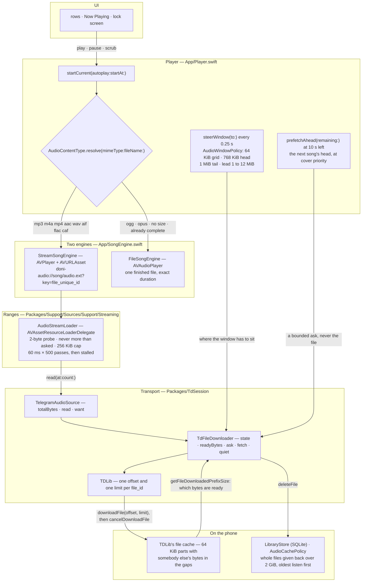
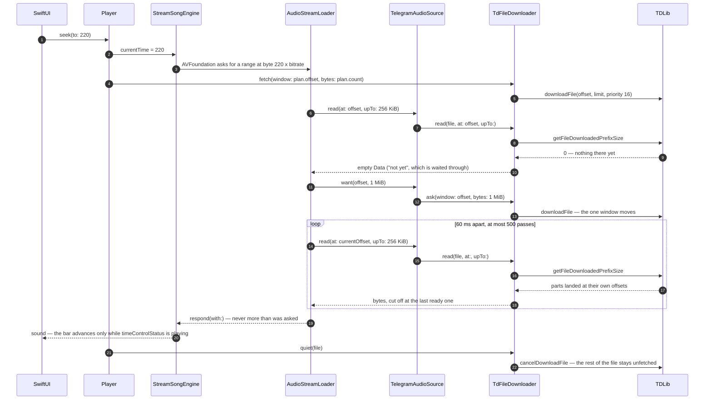

<div align="center">


# Doni

[English](../../README.md) · [Tiếng Việt](README.vi.md) · **中文** · [Español](README.es.md) ·
[Français](README.fr.md) · [Русский](README.ru.md) · [العربية](README.ar.md)

<a href="https://github.com/williamcachamwri/Doni/releases/latest"></a>

<a href="https://developer.apple.com/swift/"></a>


</div>

iPhone 音乐播放器，播放你已经存在 Telegram 里的歌：你订阅的频道，以及当作私人曲库的 Saved Messages。
背后没有服务器，不用注册账号，也不上传任何数据。

<table>
  <tr>
    <td></td>
    <td></td>
    <td></td>
    <td></td>
  </tr>
</table>

## 功能

- **立刻出声，边播边取。** 按播放位置附近的字节区间取文件，拖到 3:40 只要 3:40 附近那段，不下整个文件。
- **记住取过的部分。** 分块留在本机，被划掉应用也不丢；听完整首的歌离线还能放。
- **Cloud Music 就是 Saved Messages。** 上传即发到你自己的会话，随后删掉本机副本；在 Telegram 删除，这里也消失。
- **带时间的歌词**，来自 lrclib、NetEase、AMLL、QQ Music。正在唱的那句会替换锁屏和灵动岛上的歌名。
- **封面**取自文件内嵌标签或 Telegram 缩略图；服务端还没生成时会自动再问几次。
- **缓存有上限。** 额度由你定（默认 2 GiB），最少听的先清掉，正在放的永不删。
- 界面六种语言；代码里的源文案是越南语。

## 为什么用 Telegram

曲库本来就在那儿。每首歌是一条带文件的消息，每个文件都有 `file_unique_id`，在不同数据库里指同一串字节。
于是"这首歌是不是重复""听到哪了"由协议回答，不需要我再架一台服务器、付钱、还读你的隐私。
TDLib 负责网络：登录、重试、下载、文件缓存、CDN 跳转。Doni 只负责没人能替它决定的那部分。

## 流媒体是怎么做的

下面没有任何一层会请求整个文件。`Player` 交给 AVFoundation 一个本 app 自己的 scheme URL，
AVFoundation 向它要字节区间，而每次回答都截到 TDLib 已确认落在本机的那一字节。只有容器是
AVFoundation 解不了的、TDLib 还不知道大小、或者传输层说这些字节根本不会来，才下整首。

- `downloadFile` 有 offset 和 limit，但 limit 拦不住下载：TDLib 用 `ignore_download_limit` 响应它
  (`FileManager.cpp:3111`)，所以 limit 只决定*提问者*什么时候算被满足，文件仍在继续下。于是每个窗口
  后面都跟一次 `cancelDownloadFile`。取消不回收任何东西：分块早已写在自己的 offset 上
  (`FileDownloader.cpp:281`)，就绪位图继续把它们算在内。
- `getFileDownloadedPrefixSize` 回答*任意* offset 上已就绪多少字节，而不只是开头。这是就绪位图，
  不是"下完没有"的开关，半截文件因此仍然可用：拖回本机读过的地方不花网络。
- TDLib 每个 `file_id` 只保存一个 offset (`FileManager.cpp:3103-3107`)，它会挪动正在跑的那个窗口而
  不是再开一个下载。所以窗口只有一个，问它该在哪的有两处：某次 read 空手回来时 loader 立刻说读者在
  哪，app 的 0.25 秒心跳则计划窗口该落在哪 — 只有大约听完半窗才重新问一次，因为每 0.25 秒重问就是
  在取消自己正在到达的分块。
- 分块 64 KiB，窗口必须落在这张格子上：一个分块只能从它的开头读起，偏移一字节买回来的是没有读取者
  能用的字节。就绪区间之外的字节属于别人的文件 — 所以断网时音乐停下，而不是放噪声。
- AVFoundation 用 2 字节探测打开流，并且拒绝比请求更长的回答；而 resource loader 不是它能探测格式
  的 URL，必须把容器的 UTI 递给它，否则报回 -11850 "the server is not correctly configured"，看着像
  网络坏了，其实是少了一个字符串。

### 分层



最后两条边就是全部道理：`downloadFile` 后面总跟着 `cancelDownloadFile`，所以下载停在窗口上，不会一路
拖到 166 MB 那种 set 的末尾；而回答 AVFoundation 的那次 read 截在 `getFileDownloadedPrefixSize` 上，
所以文件中间的洞是被等待的，不是被读过去的。最后那条边是承诺的另一半：留下的字节才是离线能重听的
原因，而清理时从不碰正在播的那首 — TDLib 只能整文件回收，所以下了一半的文件也是整个删掉。

### 拖到 3:40 要付出什么



### 这些数字，以及它们各自住在哪

| 数字 | 位置 | 它决定什么 |
|---|---|---|
| 64 KiB | `AudioWindowPolicy.partBytes` | TDLib 的分块网格，每个窗口都从格子上起 |
| 768 KiB | `AudioWindowPolicy.headBytes` | 起播要的量：够解码器找到帧边界并报出长度 |
| 1 MiB | `AudioWindowPolicy.tailBytes` | 给 `m4a`/`mp4`/`aac`/`m4b` 多要的一段，它们的 `moov` 在文件末尾 |
| 1 → 12 MiB | `minimumLeadBytes` … `maximumLeadBytes` | 窗口领先播放点多远：卡顿后翻倍，缓冲宽裕到两倍需求才减半 |
| 256 KiB | `AudioStreamLoader.chunkBytes` | 单个请求最多拿到的一次回答 |
| 1 MiB | `chunkBytes * 4` | read 空手回来时，loader 让传输层往前够多远 |
| 60 ms × 500 | `pollNanoseconds` · `maximumIdlePasses` | 一个区间最多等多久 — 半分钟没有动静就判为 stalled |
| 300 ms · 25 s | `TdFileDownloader.windowPoll` · `windowPatience` | 应用多久看一次窗口落地，以及何时认定它不会来 |
| 16 · 1 | `audioPriority` · `coverPriority` | 播放点的文件，对比封面和猜的下一首 |
| 0,25 s | `Player` 的心跳 | 进度、续听快照、预取判断和窗口转向 |
| 10 s | `Player.prefetchLead` | 什么时候取下一首的头部 — 只取头部 |
| 32 KiB · 64 KiB | `Library.probe` | 消息不带长度时测长度要花多少：头部，加上为非流式 `mp4` 准备的尾部 |
| 2 GiB | `Library.defaultQuota` | 缓存上限，也是 `AudioCachePolicy` 的衡量基准 |

## 构建

需要 iOS 26、Xcode 26、[XcodeGen](https://github.com/yonaskolb/XcodeGen)、CMake、Python 3，以及
[my.telegram.org](https://my.telegram.org) 的 `api_id`/`api_hash`。

```sh
make vendor       # 从源码编 TDLib 与 OpenSSL（首次约 20 分钟）
make project      # 由 project.yml 生成工程
cp Config/Tdlib.example.xcconfig Config/Tdlib.xcconfig   # 填入自己的 id/hash/team，此文件不入库
make build        # 编译门槛：警告即错误
make device && make install
```

## 发布

一个版本两个数字，都在 `project.yml`，必须同时改。`MARKETING_VERSION` 是 About 显示、tag 必须一致的那串；
`CURRENT_PROJECT_VERSION` 是构建号，把版本编进数字里：`90 | major | minor | patch`，所以 `9010000` 就是 1.0.0。
更新日志只写在 `RELEASE_NOTES.md`，中英两栏行数相等，`make notes` 生成应用内 JSON 与 release 正文。

## 限制

- 免费个人团队签名：最多 3 台设备，证书 7 天过期。
- 发布出来的 IPA 未签名，别人要用得用自己的团队重签。发布用 `make release`（本机编译、打 tag、推送并挂上 release），Actions 里的工作流保留给手动触发，用来验证干净检出能否构建。
- 暂不支持 CarPlay：需要 `carplay-audio` 权限，也就需要付费开发者账号。
- 歌词来自公开来源；没人写过的歌就是没有，应用会直说，不给空白页。
- 检查更新只提示新版本并打开发布页，不能自装。

## 许可与致谢

GPL-3.0（[LICENSE](../../LICENSE)）——歌词界面与若干页面取自 GPLv3 的
[MeloX](https://github.com/youshen2/MeloX)。**TDLib** BSL 1.0，**OpenSSL** Apache-2.0，
**SQLite** 存放曲库与歌单，**Telegram-iOS** GPL-2.0 仅用于量取间距与配色，未取其一行的代码。

Doni 与 Telegram 或任何音乐平台无关联、亦未获授权，只打开你账号里已有的文件。

联系：Telegram [@w1lliamcachamwri](https://t.me/w1lliamcachamwri) ·
[github.com/williamcachamwri/Doni](https://github.com/williamcachamwri/Doni)

