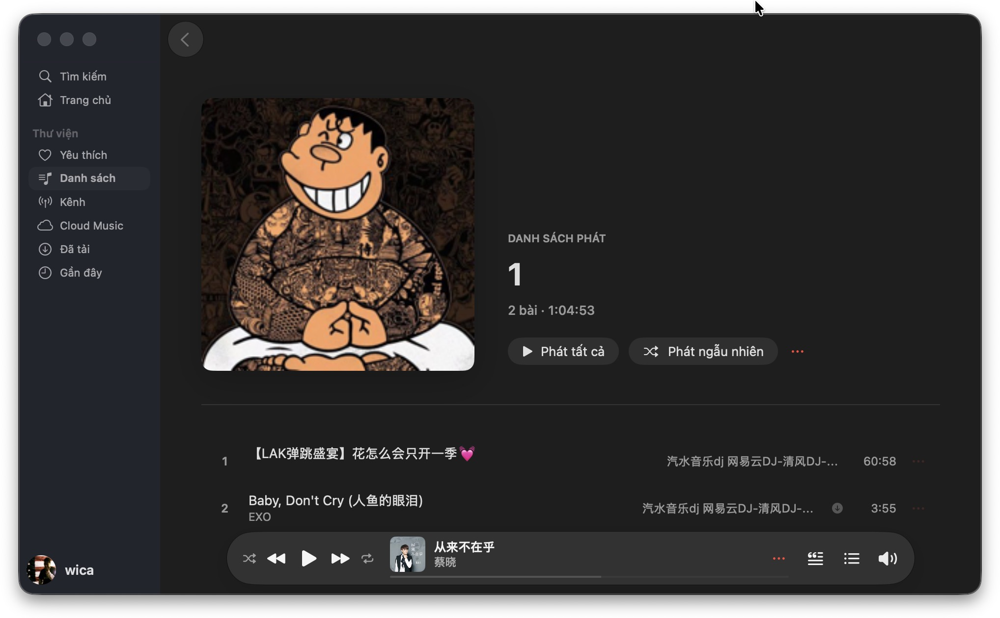
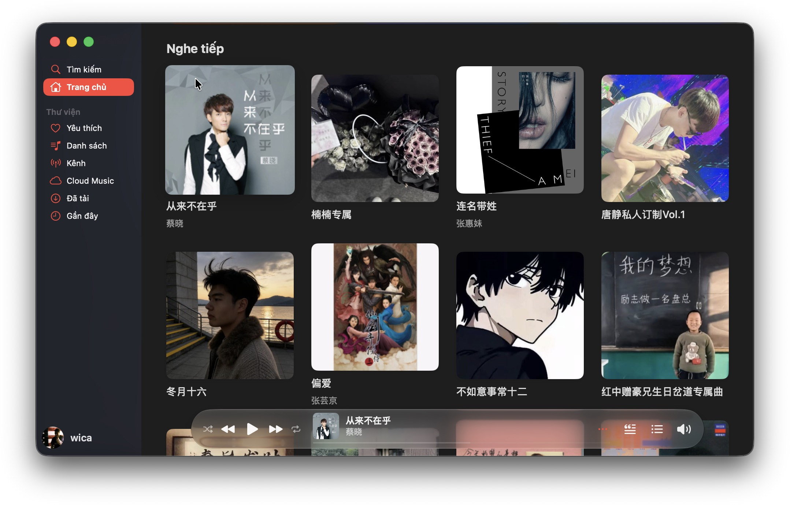
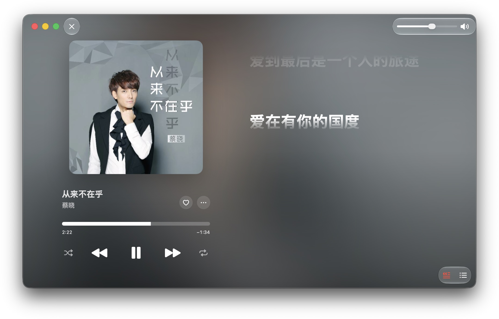
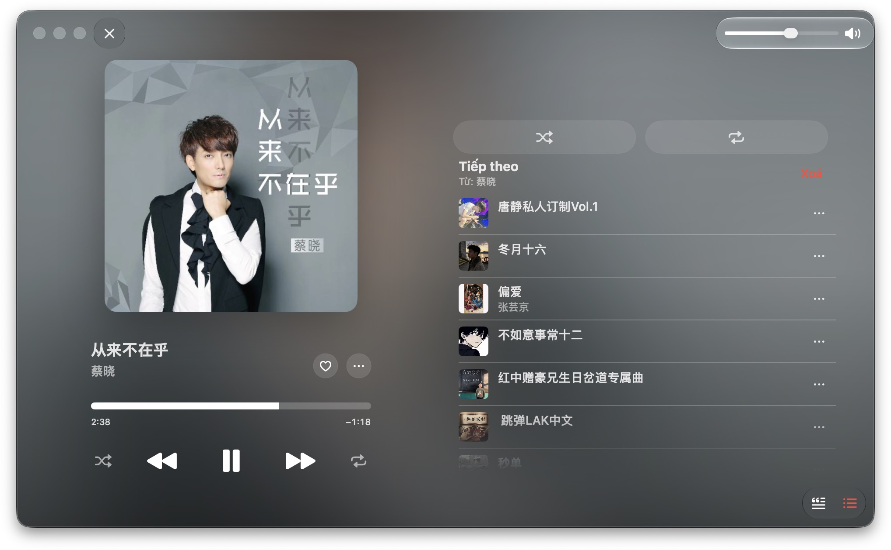
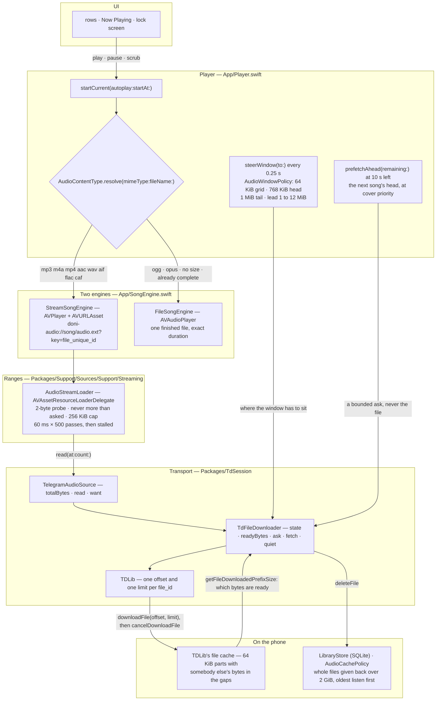
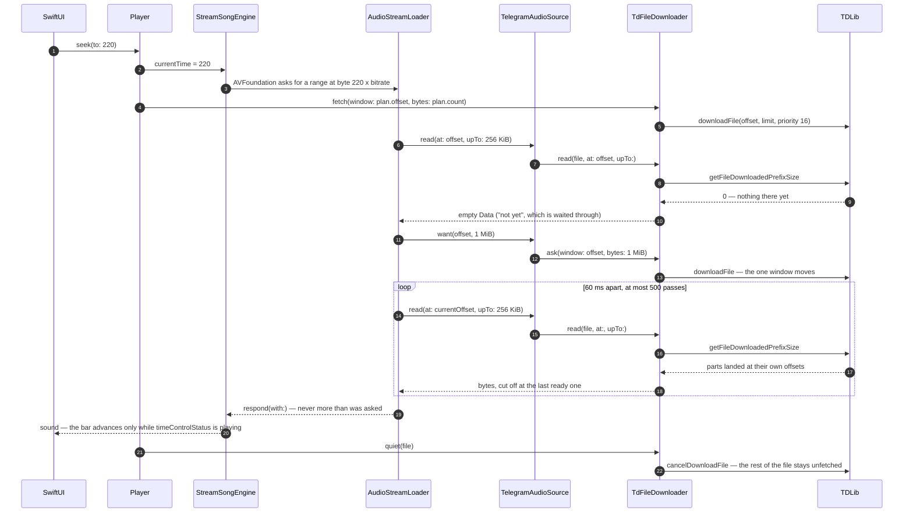

<div align="center">


# Doni

[English](README.md) · [Tiếng Việt](Docs/i18n/README.vi.md) · [中文](Docs/i18n/README.zh.md) ·
[Español](Docs/i18n/README.es.md) · [Français](Docs/i18n/README.fr.md) · [Русский](Docs/i18n/README.ru.md) ·
[العربية](Docs/i18n/README.ar.md)

<a href="https://github.com/williamcachamwri/Doni/releases/latest"></a>

<a href="https://developer.apple.com/swift/"></a>


</div>

A music player for iPhone that plays the songs you already keep on Telegram: the channels you
subscribe to, and Saved Messages as your own library. There is no server behind it, no account to
register, and nothing is reported anywhere.

### iOS

<table>
  <tr>
    <td></td>
    <td></td>
    <td></td>
    <td></td>
  </tr>
  <tr>
    <td align="center">The home feed.</td>
    <td align="center">Now Playing.</td>
    <td align="center">The line being sung, on the lock screen.</td>
    <td align="center">A list you made.</td>
  </tr>
</table>

### macOS

<table>
  <tr>
    <td></td>
    <td></td>
    <td></td>
    <td></td>
  </tr>
  <tr>
    <td align="center">A playlist.</td>
    <td align="center">The home feed.</td>
    <td align="center">Now Playing.</td>
    <td align="center">The up-next queue.</td>
  </tr>
</table>

## What it does

- **Starts at once, plays while it downloads.** A song is fetched in byte ranges around the playhead,
  so scrubbing to 3:40 asks for the part near 3:40 instead of the whole file.
- **Remembers what it took.** The ranges stay on the phone and survive being killed from the app
  switcher. A song you finished is playable with no network; a half-heard one resumes where it was.
- **Cloud Music is Saved Messages.** Uploading a file sends it to your own chat and then drops the
  phone's copy. Delete it in Telegram and it leaves this app too.
- **Lyrics with timing**, from lrclib, NetEase, AMLL and QQ Music. The line being sung replaces the
  song title on the lock screen and in the Dynamic Island.
- **Covers from wherever they exist**: the file's own tag, Telegram's thumbnail, or asked for again a
  few times when Telegram has not generated one yet.
- **A cache with a ceiling.** The quota is yours to set (2 GiB by default) and the least-heard songs
  are given back first. The song under the playhead is never a victim.
- Six languages in the interface; the strings in the code are Vietnamese.

## Why Telegram, and not a backend of my own

Because the library is already there. Every song is a message that carries a file, and every file has
a `file_unique_id` that means the same bytes in every database on every device — so "is this the same
song" and "where did I stop listening" are questions the protocol answers instead of a server I would
have to run, pay for and read the privacy of.

TDLib does the network: login, retries, downloads, the file cache, the CDN redirects. Doni does the
parts nobody else decides for it.

## How the streaming actually works

This is the part worth reading if you came to check whether it is real streaming.

The short version: no layer down there asks for a whole file. `Player` hands AVFoundation a URL of the
app's own scheme, AVFoundation asks that for byte ranges, and every answer is cut off at the last byte
TDLib has confirmed is on the phone. A song is fetched in full only when its container is one
AVFoundation cannot decode, when TDLib has no size for it yet, or when the transport says those bytes are
not coming.

- `downloadFile` takes an offset and a limit, but the limit does not bound the fetch: TDLib answers it
  with `ignore_download_limit` (`FileManager.cpp:3111`), so the limit only says when the *asker* is
  satisfied and the file keeps downloading. Every window is therefore followed by `cancelDownloadFile`.
  Cancelling takes nothing back — parts already landed were written at their own offsets
  (`FileDownloader.cpp:281`) and the ready bitmask goes on counting them.
- `getFileDownloadedPrefixSize` answers how many bytes are ready at *any* offset, not just the start.
  That is a ready bitmask rather than a done-or-not flag, and it is what makes a partial file useful: a
  scrub back to a place the phone has already read costs no network.
- TDLib holds exactly one offset per `file_id` (`FileManager.cpp:3103-3107`) and moves the window of a
  download already running instead of opening a second one. So there is one window and two owners of the
  question: the loader says where the reader is as soon as a read comes back with nothing, and the app's
  quarter-second tick plans where the window should sit — re-asked only once about half of it has been
  listened to, because a window re-asked every quarter second cancels its own arriving parts.
- Parts are 64 KiB and a window starts on that grid, because a part is readable only from its start and
  an odd offset buys bytes no reader can use. Bytes outside a ready range are somebody else's data —
  which is why a song that loses its network stops rather than playing noise.
- AVFoundation opens a stream with a 2-byte probe and rejects an answer longer than the request, and a
  resource loader is not a URL it can probe for a format: the container's UTI has to be handed over, or
  the failure comes back as -11850 "the server is not correctly configured", which reads like a broken
  network and is really a missing string.

### The tiers



Two of those edges are the whole argument. `downloadFile` is always followed by `cancelDownloadFile`, so
the fetch stops at the window instead of carrying on to the end of a 166 MB set; and the read that answers
AVFoundation is cut off at `getFileDownloadedPrefixSize`, so a hole in the middle of a file is waited for
rather than read through. The last edge is the other half of the promise: the bytes that stay are what make
a song replayable with no network, and the sweep that gives them back never touches the song under the
playhead — TDLib frees a whole file, so a partial one is evicted whole, never partly.

### What a scrub to 3:40 costs



### The numbers, and where each one lives

| Number | Where | What it decides |
|---|---|---|
| 64 KiB | `AudioWindowPolicy.partBytes` | TDLib's part grid; every window starts on it |
| 768 KiB | `AudioWindowPolicy.headBytes` | what a start asks for: enough for the decoder to find a frame boundary and report a length |
| 1 MiB | `AudioWindowPolicy.tailBytes` | the extra ask for `m4a`/`mp4`/`aac`/`m4b`, whose `moov` sits at the end of the file |
| 1 to 12 MiB | `minimumLeadBytes` … `maximumLeadBytes` | how far ahead of the playhead the window sits: doubled after a rebuffer, halved once the buffer has more than twice what it needs |
| 256 KiB | `AudioStreamLoader.chunkBytes` | the longest answer one request gets |
| 1 MiB | `chunkBytes * 4` | how far the loader tells the transport to reach when a read comes back empty |
| 60 ms, 500 times | `pollNanoseconds`, `maximumIdlePasses` | how long a range is waited for — half a minute of nothing, then it is called stalled |
| 300 ms, 25 s | `TdFileDownloader.windowPoll`, `windowPatience` | how often the app looks for a window landing, and when it concludes it is not coming |
| 16, 1 | `audioPriority`, `coverPriority` | the playhead's file against artwork and a guessed next song |
| 0.25 s | `Player`'s ticker | position, the resume snapshot, the prefetch check and the window steering |
| 10 s | `Player.prefetchLead` | when the next song's head is fetched — its head and nothing more |
| 32 KiB, 64 KiB | `Library.probe` | what a length costs when the message carries none: the head, plus a tail for an `mp4` not written for streaming |
| 2 GiB | `Library.defaultQuota` | the cache ceiling, and what `AudioCachePolicy` is measured against |

## Build it

Needs iOS 26 on the phone, Xcode 26, [XcodeGen](https://github.com/yonaskolb/XcodeGen), CMake, Python 3,
and a Telegram `api_id` / `api_hash` from [my.telegram.org](https://my.telegram.org).

```sh
make vendor       # builds TDLib and OpenSSL into a local XCFramework (~20 min, first run)
make project      # generates Doni.xcodeproj from project.yml
cp Config/Tdlib.example.xcconfig Config/Tdlib.xcconfig
# put your api_id, api_hash and team id in it — that file is gitignored and stays yours
make build        # compile gate: warnings are errors
make device       # compile and sign for your iPhone
make install      # and put it on the cable
```

`make check` runs the build, the package tests, the language gate and the release-notes gate.

## Release it

One version, two numbers, both in `project.yml` and both bumped together:

| | |
|---|---|
| `MARKETING_VERSION` | what the About screen shows and what the tag must say — `1.0.0` |
| `CURRENT_PROJECT_VERSION` | the build number, carrying the same version in its digits: `90 \| major \| minor \| patch`, so `9010000` is 1.0.0 |

Release notes are written once, in [`RELEASE_NOTES.md`](RELEASE_NOTES.md), in two languages with the
same number of lines. `make notes` turns that into the JSON the app bundles and the markdown the
release body uses; `make check` fails when the two have drifted apart.

```sh
make notes                        # RELEASE_NOTES.md → the JSON in the app + the release body
make release                      # builds here, tags the version, pushes, opens the release
```

`make release` is the short path: it runs `Scripts/build-unsigned-ipa.sh`, moves the tag onto the
commit being released, pushes both, and attaches the IPA to the release. It publishes from the
machine that already has TDLib compiled, because the macOS runner queue costs more time than the
build does and the artefact is unsigned either way.

The workflow is still there, run by hand from the Actions tab. It builds the same script on a clean
checkout, which is the question CI is actually good for: *does this build somewhere else?*

## Limits, honestly

- Signed with a free personal team: up to 3 devices, and the certificate dies after 7 days.
- The IPA built by CI is unsigned. Nobody can install it without re-signing it with their own team.
- No CarPlay yet: the audio entitlement needs a paid Apple developer account and Apple's approval.
- Lyrics come from public sources. A song nobody has typed out has no words, and the app says so
  instead of showing a blank page.
- `ogg`, `oga` and `opus` are still downloaded whole: AVFoundation cannot decode them on any iOS
  version, so ranges would only delay the first sound rather than cause it.
- Update checking tells you a newer version exists and opens the release page. It cannot install it.

## Licence and credit

GPL-3.0 ([LICENSE](LICENSE)) — parts of the interface, including the lyrics screen, were taken from
[MeloX](https://github.com/youshen2/MeloX), which is GPLv3.

- **TDLib** — Boost Software License 1.0. The Telegram library; compiled from a pinned tag into `Vendor/`.
- **OpenSSL** — Apache-2.0, so TDLib can speak TLS.
- **SQLite** — the library, playlists and hearts live in one file.
- **Telegram-iOS** — GPL-2.0. Used only to measure spacing and colour. No code from it is in this repo.

Doni is not affiliated with or authorised by Telegram or any music service. It opens files that are
already inside your own account.

## Contact

Telegram: [@w1lliamcachamwri](https://t.me/w1lliamcachamwri) · Repository:
[github.com/williamcachamwri/Doni](https://github.com/williamcachamwri/Doni)
